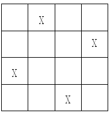
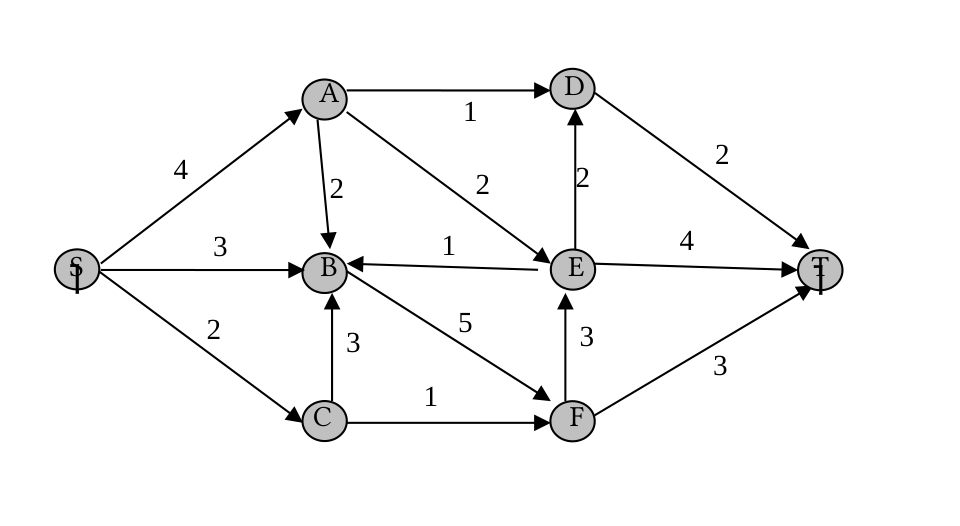
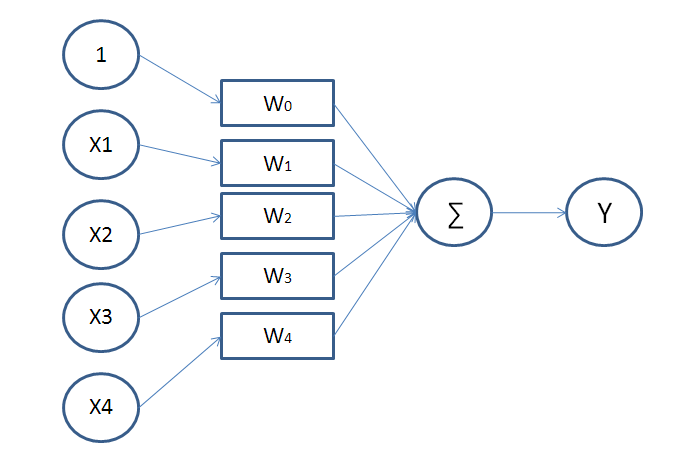
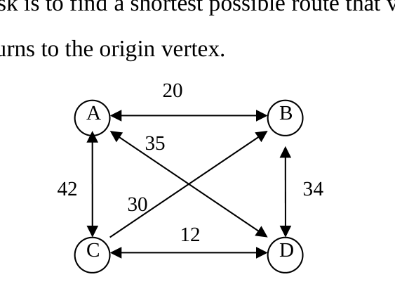
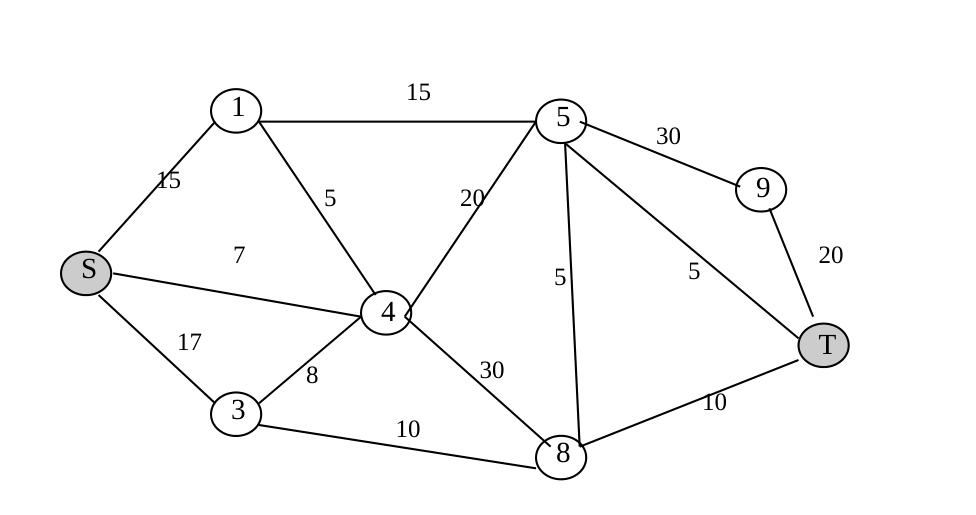
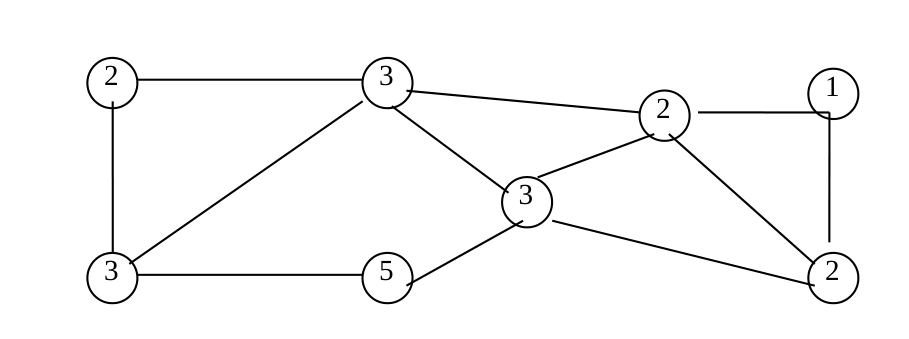
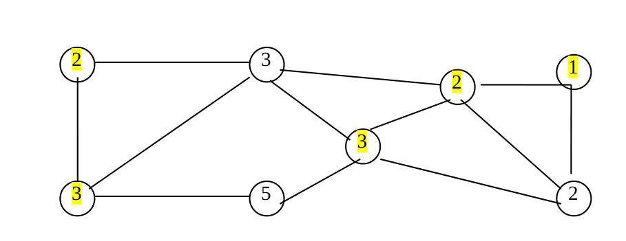
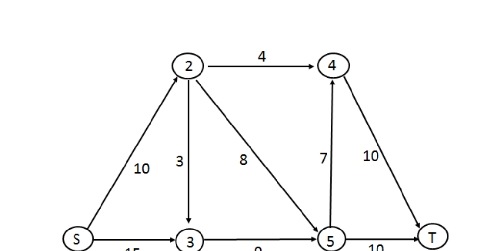

# 电子科技大学《算法设计与分析》往年考题整理

> **来源**：
> - GitHub 开源仓库 [Xovee/uestc-course](https://github.com/Xovee/uestc-course)（电子科技大学课程资料仓库）中《算法设计与分析》历年试题：2018 春/秋期末卷、多份带答案真题（"不明1/2/3"为年份不明的带答案卷）、2019 年拟考题、模拟题；
> - CSDN 博客[《电子科技大学〈高级算法设计与分析〉期末复习汇总》](https://blog.csdn.net/qq_46450354/article/details/134747493)中的 **2023 年考研期末回忆版**。
>
> **说明**：
> - 这些试卷均为**电子科技大学研究生试卷**（课程名称：算法设计与分析 / 算法分析与设计，40 学时 2 学分），与本课程 PPT（Kleinberg-Tardos 体系）完全配套，作业题（区间调度、背包、最小割、NPC 证明、近似算法）大量出现在真题中。
> - 原文档中的图片/公式凡可恢复的均已转录为文字或嵌入图片；个别位图在原 doc 中即已损坏（显示全黑），标注为【图缺失】。

---

## 目录

- [试卷一：2018 年春 期末考试（无答案）](#试卷一2018-年春-期末考试无答案)
- [试卷二：2018 年秋 期末考试（含答案）](#试卷二2018-年秋-期末考试含答案)
- [试卷三：历年真题·英文卷（含答案）](#试卷三历年真题英文卷含答案)
- [试卷四：历年真题·中文卷 A（含答案，两个版本）](#试卷四历年真题中文卷-a含答案两个版本)
- [试卷五：历年真题·中文卷 B（含答案）](#试卷五历年真题中文卷-b含答案)
- [试卷六：2019 年拟考题（复习用）](#试卷六2019-年拟考题复习用)
- [附录一：模拟题合集](#附录一模拟题合集)
- [附录二：2023 年回忆版考题](#附录二2023-年回忆版考题)
- [高频考点统计](#高频考点统计)

---

## 试卷一：2018 年春 期末考试（无答案）

### 一、判断下列陈述的对错（共 24 分，12 题，每题 2 分）

1. 任何一个 NP 完全问题能被多项式时间算法解决，则所有 NP 完全问题都能在多项式时间内被解决。（　）
2. 一个 NP 问题 A 可以多项式规约到一个问题 B，则问题 B 存在多项式时间的验证算法。（　）
3. 存在两个函数 f 和 g 使得 $f(n)=\Omega(g(n))$ 和 $f(n)=O(g(n))$ 同时成立，但不存在两个函数 f 和 g 使得 $f(n)=\omega(g(n))$ 和 $f(n)=o(g(n))$ 同时成立。（　）
4. 在不知道最优解的前提下，近似算法能保证该算法得到的解与最优解的距离在某个范围内。（　）
5. 一个 2 倍近似算法得到的解有可能比一个 1.5 倍近似算法得到的解更靠近最优解。（　）
6. 存在算法能在 $O(w^2)$ 时间内判断一个数 w 是不是素数，因此判断一个数是不是素数的问题可以在多项式时间内被解决。（　）
7. 若证明了一个问题属于 NPC，则证明了该问题不存在多项式时间算法。（　）
8. 一般来说，分治算法中若分治规则能将一个问题分为更多个子问题，则该算法更快。（　）
9. 算法 A 使用的内存比算法 B 要多，则算法 A 使用的时间一定比算法 B 要多。（　）
10. 当一个图上两点间的最大流是唯一的时候，这两点间的最小割也唯一。（　）
11. 一个运行时间为 $O(n^2)$ 的算法的基本运算步骤数可能是 30n。（　）
12. 两个不同的程序可能实现的是同一个算法。（　）

### 二、计算题和简答题（共 28 分，6 题；计算题可只写答案）

1. 如下可满足问题（SAT）是否存在解？是否存在 $x_1=1$ 条件下的解？若有解给出变量的具体赋值。（4 分）

$$(\bar{x}_1 \lor \bar{x}_2 \lor x_4) \land (\bar{x}_1 \lor x_2 \lor x_3) \land (x_2 \lor \bar{x}_3 \lor x_4) \land (\bar{x}_2 \lor x_3 \lor \bar{x}_4)$$

2. 有一些区间段 (-3,0], (0,3], (1,4], (-2,1], (3,5], (0,4], (2,6], (-1,2]，找出其中个数最多的一组相容的区间段（两个区间相容当且仅当两个区间的交集为空）。（4 分）

3. 请在（A）或（B）中选做一题：（4 分）
   - （A）叙述带权重的点覆盖问题的竞价法（Pricing method）的步骤。
   - （B）用数学表达式表示神经元数学模型，并给出主要参数的含义。

4. 写出证明一个问题是 NPC 的基本步骤，并给出最少三个著名 NPC 问题的名字。（6 分）

5. 请在（A）或（B）中选做一题：（4 分）
   - （A）四皇后问题：在 4×4 棋盘上放 4 个皇后使任何两个皇后互相不能攻击（同行/同列/同对角线能互相看到）。下图给出了一个解，请给出另一个解。
   - （B）设计一个并行算法解决 2D Mesh Synchronized Parallel-Summation（二维网格机器上的同步并行求和）问题。

   

6. 图上一个顶点子集若满足"图中任意一条边都最少有一个端点在子集中"则称为一个**点覆盖**。现有一个贪心算法求最小点覆盖：不断从图中找出一个**度数最大**的顶点放入解集中，并从图中删除这个顶点及与它相邻的所有边，直到图中不存在任何边。请构造一个例子说明该贪心算法**找不到最优解**；再构造一个例子说明该贪心算法**不是 1.5 倍近似算法**。（6 分）

### 三、函数增长率排序（8 分）

将下列 5 个函数按渐近增长率由低至高排序，要求写出比较过程（各 log 底数均为 2）：

$$f_1(n)=n(\log n)^n,\quad f_2(n)=2^{\log\log n},\quad f_3(n)=(\log n)^5,\quad f_4(n)=\sqrt[3]{n},\quad f_5(n)=\sqrt[10]{n}(\log n)^{50}$$

### 四、最大流（8 分）

求下图中 S 和 T 间的**最大流**，要求给出最少两个中间计算步骤。

边表（便于演算）：S→A:4，S→B:3，S→C:2，A→D:1，A→B:2，A→E:2，E→B:1，E→D:2，D→T:2，E→T:4，B→F:5，C→B:3，C→F:1，F→E:3，F→T:3。

### 五、分治排序策略（10 分）

对 n 个数排序，有三种分而治之策略：
- 算法 1：递归分成 2 个子问题，各 n/2（不整除则向上/向下取整），排序后合并；
- 算法 2：递归分成 3 个子问题，各 n/3（取整使子问题大小之和为 n），排序后合并；
- 算法 3：递归分成 4 个子问题，各 n/4（取整使子问题大小之和为 n），排序后合并。

**问题 1**：设计一个线性时间算法将**四个**已排序数列合并成一个有序数列。（4 分）
**问题 2**：假设三个算法的合并步骤都能在线性时间内完成，分析三个算法的运行时间。（6 分）

### 六、自身规约（6 分）

证明：如果能在多项式时间内判断图中是否存在一个大小为 k 的**完全子图**，则可以在多项式时间内**找到**图中一个大小为 k 的完全子图（如果该子图存在）。

### 七、P 与 NP（6 分）

证明：判断图中两点之间是否存在一条长度**小于 k** 的路径的问题属于 **P**；判断图中两点之间是否存在一条长度**大于 k** 的路径的问题属于 **NP**。

### 八、动态规划：最长公共子序列（10 分）

字符序列的子序列是从该序列中随意去掉若干字符（可能一个也不去掉）后形成的序列。给出两个字符序列，用**动态规划**求它们的最长公共子序列。对实例 **ATCGATGC** 和 **AATGATCC** 进行计算并给出计算过程（画表）。

---

## 试卷二：2018 年秋 期末考试（含答案）

### 一、判断题（共 30 分，15 题，每题 2 分）

| # | 题目 | 答案 |
|---|---|:---:|
| 1 | 任何一个 NP 问题能被多项式时间算法解决，则所有 NP 问题都能在多项式时间内被解决 | F |
| 2 | 可以如下方法证明某结论 X 成立：先假设 X 不成立，在此基础上推导出 X 成立，则可以证明 X 成立 | **T** |
| 3 | 一个 2 倍近似算法得到的解总比一个 4 倍近似算法得到的解更好 | F |
| 4 | 问一个图是否**存在**大小为 k 的点覆盖，很容易证明属于 NP；但问是否**不存在**大小为 k 的点覆盖，却很难证明该问题是否属于 NP | **T** |
| 5 | 一个问题 A 可以多项式时间规约到一个 NP 完全问题 B，那么 A 可能属于 P 也可能属于 NP 完全 | **T** |
| 6 | 一个 3 倍近似算法如果对任何问题实例其解都在最优解的 1.5 倍以内，则这不是一个 3 倍近似率的算法 | F |
| 7 | 对某问题以前最好的算法运行时间为 O(n³)，新算法为 O(n²)，则运行时间改进了 O(n) | F |
| 8 | 对于判断一个整数是不是素数的问题，一个运行时间为【公式缺】的算法是多项式时间算法，而一个运行时间为【公式缺】的算法是指数时间算法 | F |
| 9 | 证明一个算法不是 2 倍近似算法，只需构造一个例子使返回的解超过 2 倍最优解 | **T** |
| 10 | 如果一个图上两点间的最大流是唯一的，则可以确定这两点间的最小割也唯一 | F |
| 11 | 证明把问题 A 规约到了问题 B，只需证明：对任意 A 的实例 I 都可构造 B 的实例 I′，使得 I′ 的任意解可以构造出 I 的一个解 | F |
| 12 | 动态规划算法有可能是多项式时间的，也有可能是指数时间的 | **T** |
| 13 | 一个二分图如果包含奇数个顶点，则这个图一定不存在哈密尔顿圈 | **T** |
| 14 | 不属于 NP 中的问题一定不存在多项式时间算法 | F |
| 15 | 对于每秒处理 100 万条基本指令的计算机，一个运行时间为 $1.5^n$ 的算法在 n=100 的例子上可以在 1 年内计算完 | F |

### 二、计算题和简答题（共 16 分，4 题，每题 4 分）

1. **逆序计数**：序列中排在前面的数比后面的数大则称为一对逆序。问序列 5, 10, 7, 9, 13, 1, 8, 4, 12, 2, 6, 3, 11, 14 中存在多少对逆序？
   - **答：42**（4+8+5+6+8+0+4+2+4+0+1+0+0=42；答案错误且无步骤全扣）
2. **负载均衡 2-近似证明**：将任务按任意次序依次分配到负载最轻的机器上。简单证明该算法是 2 倍近似的。
   - **答**：见第 5 章 PPT。考虑瓶颈机器 i 的负载 L[i]，设 j 为 i 上最后安排的任务，分配 j 时 i 负载最小 ⟹ L[i]−t_j ≤ L[k] 对所有 k；对所有 k 求和除以 m，再结合 L* ≥ max t_j 与 L* ≥ (1/m)Σt_j 得 L[i] ≤ 2L*。
3. 选做一题：
   - （A）叙述带权点覆盖问题的竞价法（Pricing method）的步骤。（见第 5 章 PPT）
   - （B）神经元数学模型：
     **答**：令 X={1, x₁, x₂, x₃, x₄}，W={w₀, w₁, w₂, w₃, w₄}，Y = f(X·W+b)，其中 Y 为神经网络输出，f 为激活函数，X 为输入，W 为连接权重。
4. 选做一题：
   - （A）**多对顶点流**：无向图给定 (s₁,t₁)、(s₂,t₂)，求 s₁→t₁ 的流加上 s₂→t₂ 的流的最大值。某算法：添加新顶点 s 仅连 s₁、s₂（容量无穷），添加新顶点 t 仅连 t₁、t₂（容量无穷），求 s 到 t 的最大流。分析正确性。
     **答：错误**——会包含从 s₁ 到 t₂ 的流和从 s₂ 到 t₁ 的流。
   - （B）简述并行算法 PCAM 设计方法学四步骤与性能指标。
     **答**：任务分解、通信设计、任务组合、处理器映射；性能指标：执行时间、效率与加速比、可扩展性。

### 三、函数增长率排序（8 分）

将下列 6 个函数按渐近增长率由低至高排序，写出判断依据（log 底数均为 2）：

$$f_1(n)=\sqrt{n}+(\log n)^{100},\quad f_2(n)=2^{\log n+\log\log n},\quad f_3(n)=\log(n^{100}\times 3^n)$$
$$f_4(n)=n^{200}+3^n,\quad f_5(n)=\log(n^{100\log n}),\quad f_6(n)=100^n+n!$$

**答**：$f_1=\Theta(n^{0.5})$，$f_2=n\log n$，$f_3=\Theta(n)$，$f_4=\Theta(3^n)$，$f_5=\Theta(\log^2 n)$，$f_6=\Theta(n!)$；
**排序：f₅ < f₁ < f₃ < f₂ < f₄ < f₆**。（只有答案无判断过程扣 2 分）

### 四、最小割（8 分）

求有向图 s 和 t 间的**最小割**（边上数字为容量），要求给出最少两个中间计算步骤。【图缺失】

**答**：转化为最大流问题——
增广路径 #1： (s, u, t)，流量 +5；#2： (s, x, t)，+5；#3： (s, v, w, t)，+8；#4： (s, u, w, v, x, t)，+3。
**最小割容量 = 21**。（只给割不给大小扣 1 分）

### 五、分治算法分析（6 分）

对输入规模 n 的问题有三个分治算法：
1. 分成 5 个子问题、每个 n/5，合并需 O(n²)；
2. 分成 4 个子问题、每个 n/2，合并需 O(n)；
3. 分成 2 个子问题（n/3 与 2n/3），合并需 O(n)。

**答**：算法 1：O(n²)；算法 2：O(n²)；算法 3：O(n log n)。（递归关系式 1 分 + 答案 1 分）

### 六、自身规约：三着色（8 分）

对三着色问题：若存在多项式时间算法**判断**一个图是否可以三着色，则存在多项式时间算法对可三着色的图**找到**一个可行的三着色。

**答**：
- 解法一：不断加边进去然后判断，直到不能加边为止，三种颜色的点即图中三个独立集；
- 解法二：不断将两个不相邻的点合并成一个点再判断，直到不能再合并，最后剩下三个点。

### 七、NPC 证明（10 分）

给出一个图和整数 k，问是否可以**删除 k 个点使剩余图上没有三角形**（3 顶点的圈）。证明该问题是 NP 完全的。

**答**：从**点覆盖**规约（2 分）。对点覆盖实例 G 构造 G′：对 G 中每条边 ab 添加新顶点 c 连成三角形 abc（4 分）。说明 G 存在大小 k 的点覆盖 ⟺ G′ 存在大小 k 的解（3 分）。

### 八、动态规划：矩阵链乘（14 分）

给定 n 个矩阵的连乘积（矩阵乘法满足结合律），不同计算次序所需乘法次数不同。
1. 设计 DP 算法求最优计算次序（完全加括号），要求给出子问题定义和递归关系式。（8 分）
2. 对实例求解，给出表格和最优加括号方式（6 分）：

| A₁ | A₂ | A₃ | A₄ | A₅ |
|---|---|---|---|---|
| 12×15 | 15×8 | 8×20 | 20×10 | 10×16 |

**答**：m[i,j] 为计算 Aᵢ…Aⱼ 所需最少乘法次数，$m[i,j]=\min_{i\le k<j}\{m[i,k]+m[k+1,j]+p_{i-1}p_kp_j\}$（边界 m[i,i]=0）。
表格：

| m(i,j) | j=1 | j=2 | j=3 | j=4 | j=5 |
|---|---|---|---|---|---|
| i=1 | 0 | 1440 | 3360 | 4000 | 5856 |
| i=2 | / | 0 | 2400 | 2800 | 4800 |
| i=3 | / | / | 0 | 1600 | 2880 |
| i=4 | / | / | / | 0 | 3200 |
| i=5 | / | / | / | / | 0 |

最优加括号方式：**(A₁(A₂A₃))((A₄A₅))**（由 s 表：s(1,2)=1, s(1,3)=2, s(1,4)=2, s(1,5)=2；s(2,3)=2, s(2,4)=2, s(2,5)=2；s(3,4)=3, s(3,5)=4; s(4,5)=4，即 (A₁·(A₂A₃))·((A₄)·(A₅)) 组合）。

---

## 试卷三：历年真题·英文卷（含答案）

### 一、True or False（共 10 分，5 题，每题 2 分）

1. The knapsack problem can be solved in polynomial time by using dynamic programming. **( F )**
2. Some problems in NP can be solved in polynomial time. **( T )**
3. To show a problem is NP-hard, we can reduce it to a well-known NP-Complete problem. **( F )**（方向反了：应从已知 NPC 问题规约到它）
4. In an undirected graph, the value of the maximum flow between two vertices is equivalent to the value of the minimum cut between them. **( T )**
5. 【公式缺】 **( F )**

### 二、函数增长率排序（6 分）

Arrange the following functions in ascending asymptotic order: 【公式缺】
**参考答案**：f₂, f₃, f₁, f₄, f₅（每错一对扣 1 分）

### 三、简答（共 6 分，每题 3 分）

(a) What are the main steps of designing a dynamic programming algorithm?
**答**：1. 定义子问题；2. 根据子问题建立递归关系式；3. 自底向上求解（建立存储表）。

(b) What are the main steps of proving the NP-Completeness of a problem?
**答**：1. 证明该问题属于 NP；2. 选一个已知的 NPC 问题 B；3. 将 B 归约到该问题上（第一步可放在第三步）。

### 四、TSP 与最长有向圈（8 分）

TSP: given a graph, find a shortest route that visits each vertex exactly once and returns to the origin.

有向边：A→B:20，A→D:35，C→A:42，C→B:30，C→D:12，D→B:34（反向边权同图计）。

(a) find a solution to TSP (starting from A and back to A)；（4 分）
(b) find a longest directed cycle that contains vertex A。（4 分）

**参考答案**：(a) A→D→C→B→A = 35+12+30+20 = **97**；(b) A→C→B→D→A = 42+30+34+35 = **141**。

### 五、区间调度算法设计（6 分）

Design an algorithm for Interval Scheduling: n jobs each with start time s and finish time f; two jobs compatible if they don't overlap; find a maximum set of mutually compatible jobs.
**答**：按完成时间先后排序（2 分）；依次选取最小完成时间且与已选工作不冲突的工作（4 分，未说明不冲突扣 1 分）。

### 六、最小割（9 分）

Find a minimum s-t cut (numbers beside edges are capacities). Give computation steps and show the size of the cut.

**参考答案：35**。有两个解：{S, 4, 3, 8} 和 {S, 1, 2, 3, 4, 5, 6, 7, 8, 9}。
（评分：说明求 s 到 t 最大流 2 分；给出第一个增广路 2 分；后面任意两个增广路各 1 分；结果 35 与割 3 分）

> 注：**此图与本课程作业二第 1 题完全相同**（作业即选自真题）。

### 七、路径的自身规约（6 分）

Prove: if we can check if a graph has a path of length k in polynomial time, then we can also find a path of length k in polynomial time.
**答**：依次从图中删除一条边，检查是否还存在长度为 k 的路径：存在则直接删除该边，不存在则保留；最后图中剩下的 k 条边即一条长度为 k 的路径。（删除点检测给 4-5 分）

### 八、受约束哈密尔顿圈规约（6 分）

Hamiltonian Cycle: find a cycle containing each vertex. Constrained Hamiltonian Cycle: find a Hamiltonian cycle passing through some **given edges**. Give a polynomial reduction from Constrained HC to HC.
**答**：在每个要求通过的边上添加一个度数为 2 的新顶点，这样 Hamilton cycle 就必须通过这些边了。

### 九、带权点覆盖：整数规划 + LP 舍入（12 分）

(a) Integer programming formulation of Weighted Vertex Cover；（4 分）
(b) A 2-approximation algorithm based on linear programming；（4 分）
(c) Prove the approximation ratio 2。（4 分）

**参考答案**：
(a) $\min \sum_i w_i x_i$，s.t. $x_i+x_j \ge 1$ for each edge $(i,j)$；$x_i = 0$ or $1$ for each vertex i；
(b) 改为线性规划（$0 \le x_i \le 1$），求解后将 $x_i \ge 0.5$ 的点选入点覆盖；
(c) 证明见教材：覆盖性由 $x_i+x_j\ge1$ 保证；权值 $w(S)\le \sum_i 2w_ix_i^* = 2\cdot LP^* \le 2\cdot OPT$。

### 十、负载均衡 LPT（8 分）

m machines and n=2m+1 jobs: two jobs of each length (m+1, m+2, …, 2m) respectively, and one job of length m.
(a) Give an approximation solution using the LPT algorithm；(b) Find an optimal solution.

**参考答案**：
(a) LPT：按处理时长**降序**排列，总是将当前最长任务分配到目前负载最低的机器；
(b) 最优 makespan = **3m+2**（总长 3m²+2m，m 台机器均分 (3m²+2m)/m = 3m+2）。

### 十一、规约链（8 分）

Give a polynomial reduction from Vertex Cover to Independent Set, and from Independent Set to Clique.
**答**：VC→IS：除去 vertex cover 中的点，剩下的点即 independent set（4 分）；IS→Clique：取补图 G′，G 中的 independent set 即 G′ 中的 clique（4 分）。

### 十二、动态规划：双份背包（15 分）

There are n types of items and **each type has two pieces** (2n items total). Item i has weight wᵢ and value vᵢ; knapsack capacity W. Maximize value.
(a) Define your subproblem；（2 分）
(b) Give the recurrence relation；（5 分）
(c) Solve the instance by bottom-up method with the table.（8 分）

| Items | Weight | Value |
|:---:|:---:|:---:|
| 1 | 1 | 2 |
| 2 | 2 | 3 |
| 3 | 4 | 8 |
| 4 | 3 | 2 |
| 5 | 5 | 9 |

**Table 1**: 5 items, each with two pieces; capacity = 10 kg.

**参考答案**：
(a) OPT(i, w) = 只选前 i 种物品、容量 w 的最优解；
(b) 每种物品有 0/1/2 件三种选择：$OPT(i,w)=\max\{OPT(i-1,w),\ OPT(i-1,w-w_i)+v_i,\ OPT(i-1,w-2w_i)+2v_i\}$（取可行者）；
(c) 填表求解（若忽略"每种两件"按普通背包做，则总分按 10 分计）。

---

## 试卷四：历年真题·中文卷 A（含答案，两个版本）

> 版本 1（v1）与版本 2（v2）题干基本相同，个别小题与答案不同；两版差异处均已注明。
> （原卷函数带"2014"字样，推断为 2014 级前后试卷。）

### 一、判断题（共 20 分，10 题，每题 2 分）

| # | 题目 | v1 答案 | v2 答案 |
|---|---|:---:|:---:|
| 1 | 一个计算问题的输入是 n 个数字 a₁,…,aₙ。如果存在运行时间为 O(aₙ·n¹⁰) 的算法，则该问题可在多项式时间内被求解 | ╳ | ╳ |
| 2 | 如果存在从问题 A 到问题 B 的多项式时间归约，且 A 是 NP 难的，则 B 也是 NP 难的 | **√** | ╳（注：v1 正确，A≤pB 且 A 难 ⟹ B 难） |
| 3 | 一个 2 倍近似算法一定会在某个问题上得到正好是最优解两倍的解 | ╳ | ╳ |
| 4 | 如果存在一个 NP 问题有多项式时间算法，则 P=NP | ╳ | ╳ |
| 5 | 一个图上的最大网络流是唯一的 | ╳ | ╳ |
| 6 | 当图中顶点个数是常数时，最大独立集问题是多项式时间可解的 | **√** | **√** |
| 7 | 算法 A 递归均分 2 份排序后合并；算法 B 均分 3 份排序后合并。从渐进分析角度看 B 比 A 快 | ╳ | ╳ |
| 8 | 一个问题能在 CREW PRAM 模型下 O(n) 处理器 O(n³) 时间解决，则也能在 EREW PRAM 模型下 O(n) 处理器 O(n³) 时间解决 | **√** | **√** |
| 9 | 对任意动态规划算法，其使用的空间一定不比使用的时间大 | **√** | **√** |
| 10 | 求两点间最长路径的问题属于 NP，但求两点间最短路径的问题不属于 NP | ╳ | ╳ |

### 二、计算题（共 9 分，3 题，每题 3 分）

1. 求有向图中一个最长路径，给出路径和路径长度。【图缺失】

   边表（由答案逆推）：C→A:40，A→D:30，D→B:35，A→B:20，C→B:30，C→D:22。
   **答**：CADB，长度 40+30+35 = **105**（写 135 也算对）。

2. 可满足问题（SAT）是否有解，若有解如何赋值：

$$(\bar{x}_1 \lor x_2 \lor x_3) \land (x_1 \lor \bar{x}_2 \lor x_3) \land (\bar{x}_1 \lor x_2 \lor x_3) \land (\bar{x}_1 \lor \bar{x}_2 \lor \bar{x}_3)$$

   **答**：x₁=1, x₂=1, x₃=0 或者 x₁=0, x₂=0, x₃=0（存在多组解，如 x₃=1 且 x₁、x₂ 中有一个 0 也仍有解，任给一种即可）。

3. 区间段 (0,3), (2,4), (3,6), (5,7), (1,4), (3,5), (6,8), (7,9)，找个数最多的一组相容区间段。
   **答**：(0,3)，(3,5)，(5,7)，(7,9)。

### 三、函数增长率排序（7 分）

按渐近增长率由小到大排列并给出判断依据：

| 函数 | 表达式 | 阶 |
|---|---|---|
| f₁ | $2014n^6+5n^4$ | Θ(n⁶) |
| f₂ | $n^{2014}+3^n$ | Θ(3ⁿ) |
| f₃ | 【上下标可能转录有误，原卷疑为 $2014^n$】 | 见答案 |
| f₄ | $\log n + (2014\log n)^3$ | Θ((log n)³) |
| f₅ | $2^n+n!+5^n$ | Θ(n!) |
| f₆ | $3\log(2n)+\log\log n$ | Θ(log n) |
| f₇ | $2^n\log n+\log^n n$ | Θ(nⁿ)（原卷判定依据） |

**参考答案**：f₄ < f₆ < f₃ < f₁ < f₂ < f₅ < f₇（每个错误位置扣 1 分；无判断依据酌情扣分）。
> 注：原 doc 公式上标在格式转换中部分丢失，f₃、f₇ 的准确形式请以原 doc 为准。

### 四、运货车贪心（8 分）

一堆货物需运走，四种车容量：推车最小 < 小货车（=2×推车）< 中货车（=2×小货车+1×推车）< 大货车（=1×中货车+1×小货车+2×推车）。四种车数量充足。要求除推车外其他车必须**装满**才能发车。设计派出**最少辆车**的算法并证明正确性。

**答**：贪心：车型按容量由大至小，能装满大车就先装满发车，不行考虑小一级的车。
证明（交换论证）：设算法解为推车/小/中/大各 a₁,a₂,a₃,a₄ 辆，最优解为 b₁,…,b₄；设 aᵢ 与 bᵢ 不同且 i 最大：若 i=4，可将两个中货车（或 4 个小货车）换成一个大货车加一个推车，或一个中货车加两个小货车换成一个大货车……；i=3 时两个小货车和一个推车换成一个中货车；i=2 时两个推车换成一个小货车——逐步将最优解变换为算法解而车数不减，故算法最优。

### 五、分治算法分析（8 分）

1. 分成 2 个子问题（n/3），合并 O(n)；
2. 分成 3 个子问题（n/2），合并 O(n)；
3. 分成 4 个子问题（n/2），合并 O(n²)；
4. 分成 3 个子问题（n−1），合并 O(1)。

**答**：算法 1：O(n)；算法 2：O(n^{log₂3})；算法 3：O(n² log n)；算法 4：O(3ⁿ)。

### 六、最小割（8 分）

求图中 S 和 T 间的最小割。【图缺失】
**答**：**16**。（求最大流 2 分；第一、二条增广路 2 分；后面任意两条各 1 分；结果 16 与割 [{S,A,B,C,D,E}, T] 3 分）

### 七、路径自身规约（6 分）

证明：如果存在多项式时间算法判断图中是否存在长度为 k 的路径，则存在多项式时间算法要么找到一条长度为 k 的路径，要么证明不存在。
**答**：先判断是否存在，不存在直接返回；存在则逐条边删除测试：删除边 e 后若仍存在长度 k 路径则真删除，否则保留；测试完所有边后剩下的即长度为 k 的路径。

### 八、竞价法（8 分）

叙述带权点覆盖问题的竞价法（Pricing Method），并证明它是 2 倍近似算法。
**答**：竞价法叙述（5 分）+ 2 倍近似证明（3 分），参考 PPT 讲义（公平价格引理 Σpₑ ≤ w(S)；紧点集 w(S) = Σ_{紧点}Σ pₑ ≤ 2Σpₑ ≤ 2w(S*)）。

### 九、整数规划建模（5 分）【两版不同】

- **v1**：为**最大团**问题建立整数规划模型。
  **答**：直接建模较复杂（转化成最大独立集或点覆盖后再建 IP 可得 4-5 分；直接写最大独立集的 IP 给 3 分）。
- **v2**：为**最大独立集**问题建立整数规划模型。
  **答**：目标 max Σᵢ xᵢ；约束：对每条边 ij，$x_i+x_j\le 1$；对每个顶点 i，$x_i \in \{0,1\}$。

### 十、NPC/NP-难证明（5 分）【两版不同】

- **v1**：说说**支配集**和点覆盖的差别，证明支配集问题是 NP 难的。（支配集：S ⊆ V，使得 V−S 中任何一个点 v 都有 S 中的点 u 与其相邻）
  **答**：举例说明支配集不一定是点覆盖（3 分）；NP-难证明可从点覆盖归约，也可从 3-SAT 归约（2 分）。
- **v2**：一组边集 A 中任何两条边无公共顶点、且来自不同边的任意两顶点之间**不存在边**，称 A 为**独立匹配**。证明求最大独立匹配是 NP 难的。（提示：从最大独立集构造规约）
  **答**：对 G 中每个顶点 v 添加新顶点 v′ 且 v′ 仅与 v 相邻得图 H：G 的最大独立集 ⟺ H 的最大独立匹配。

### 十一、选做（10 分）

- （一）**子集和 DP**：输入 n 个正整数的集合 A 和正整数 k，问是否存在子集元素和恰为 k。设计 DP 算法并对 A={1,2,5,6,7}, k=11 求解（画表格）。
  **答**：可用背包 DP；或定义 OPT(i)=1 表示存在子集和恰为 i（x(i)=1 当 A 中存在元素等于 i），递推合并；实例解为 **Yes**（如 1+2+3?→ 5+6=11 或 1+5+... 实际 2+4?，可取 {5,6} 或 {1,5,...}——{2,4,5}=11? 4 不在集合；{5,6}=11 ✓）。
- （二）**超递增序列**：M 个用户各 N 维数据 d_ij，用超递增序列技巧设计多维数据的聚合与解码方案。

### 十二、选做（6 分）

- （一）在 EREW PRAM 模型下设计快速并行算法求 n 个数中第 3 小的数，分析时间复杂度和工作复杂度。
  **答**：O(log n) 时间、O(n) 工作复杂度。
- （二）简述 PCAM 四步骤、人工神经网络、计算智能三个研究领域（神经计算、模糊计算、进化计算）。

---

## 试卷五：历年真题·中文卷 B（含答案）

### 一、判断题（共 20 分，10 题，每题 2 分）

| # | 题目 | 答案 |
|---|---|:---:|
| 1 | 问题 A 可以平方时间归约到问题 B，且 B 存在线性时间算法。这说明 A 不可以在线性时间内被解决但能在平方时间内被解决 | **F** |
| 2 | 如果 P ≠ NP，则不存在从一个 NP 难问题到 P 问题的多项式归约 | **T** |
| 3 | 在区间段 (0,3), (2,4), (3,6), (5,7), (1,4), (3,5), (6,8), (7,9) 中，不存在一组 **5 个**两两相容的区间段 | **T** |
| 4 | 动态规划算法因需储存子问题的解，不可能只使用线性大小的内存 | **F** |
| 5 | 一个图上两点间的最大网络流若是唯一的，则这两点间的最小割也是唯一的 | **F** |
| 6 | 一般来说，分治算法中若分治规则能将一个问题分为更多个子问题则该算法更快 | **F** |
| 7 | 算法 A 使用的内存比算法 B 多，则 A 使用的时间一定比 B 多 | **F** |
| 8 | 一个串行 O(n³) 时间可解的问题，可以在 n 个处理器的并行模式下 O(n²) 时间内被解决 | **F** |
| 9 | 一个 2 倍近似算法可以在不知道最优解的前提下求得一个解在最优解 2 倍以内 | **T** |
| 10 | 任意两个属于 NPC 的问题之间都存在多项式时间的归约 | **T** |

### 二、计算题和简答题（共 24 分，7 题：前四题每题 3 分，后三题每题 4 分；前四题可不写过程）

1. **逆序计数**：序列 4, 6, 3, 7, 12, 1, 9, 2, 7, 10, 5, 11, 8 的逆序数。**答：28**。
2. **带权最小点覆盖**：给出带权图（点上数字为权重），求带权最小点覆盖的大小、个数及具体方案。

   

   **答：11**，有一组（答案图高亮点）：

   

3. **SAT**：$(\bar{x}_1 \lor \bar{x}_2 \lor x_3) \land (x_1 \lor x_2 \lor x_4) \land (\bar{x}_1 \lor x_2 \lor x_3) \land (x_1 \lor \bar{x}_2 \lor \bar{x}_4)$ 是否有解？
   **答**：有解，如 x₁=1, x₂=0, x₃=1, x₄=1。
4. **划分子集和（PARTITION 实例）**：数组 (23, 45, 17, 9, 20, 29, 5, 24) 能否分成两组使两组和相等？
   **答**：可以。总和 172，各 86：(17, 24, 45) = 86 与 (23, 9, 20, 29, 5) = 86。
5. **多对顶点最小割**：给出图中两对顶点 (s₁,t₁)、(s₂,t₂)，求一个**最小割**同时割断 s₁ 与 t1、s₂ 与 t₂。考虑如下算法：添加新顶点 s 只连 s₁、s₂，新顶点 t 只连 t₁、t₂，求新图 s-t 最小割。分析正确性。
   **答**：**算法错误**——s-t 间的割会把 s₁ 与 t₂ 也割开，这在原问题中不需要。（只答"错误"给 2 分，理由不充分扣 1-2 分）
6. **独立匹配等价性**：构造图 H：对 G 中每个顶点 v 添加新顶点 v′ 使 v′ 只与 v 相邻。说明 H 中的最大独立匹配大小 = G 中最大独立集大小。
   **答**：证明 G 的独立集对应 H 的独立匹配（恰好用到独立集顶点及其新加顶点），反之亦然。
7. **竞价法**：叙述点覆盖问题的竞价法（Pricing Method）。**答**：见教材或 PPT。

### 三、函数增长率排序（6 分）

按渐近增长率由小到大排序并给出判断依据：$f_1(n)=n\log n+\log n\cdot n$，【f₂–f₄ 公式缺】，$f_5(n)=2015$，$f_6(n)=100\log(2n)+\log^{100}\log n$，$f_7(n)=2^n\log n+\log^n n$。

**答**：f₆ < f₅ < f₄ < f₁ < f₂ < f₃ = f₇（无判断依据扣 3 分；排错一个扣 1 分）。
> 注：原卷 f₂–f₄ 公式在转换中丢失，以原 doc 为准。

### 四、区间划分/讲座安排（8 分）

某学院一天要安排 n 个讲座，讲座 i 有开始时间 sᵢ 与结束时间 tᵢ，时间有交叉的讲座不能同教室（结束时间恰好等于开始时间也算交叉）。设计算法使所用教室最少，并对实例给出结果：
[9,10], [9,11], [11,13], [11,12], [12,14], [9,12], [17,18], [14,15], [13,15], [10,13], [15,17]。

**答**：贪心（按开始时间排序、优先放入相容教室 / 深度论证），**最少需要 5 个教室**。（思路 2-3 分，过程 2-3 分，结果 2 分）

### 五、动态规划：最长公共子序列（10 分）

用 DP 求两字符序列的最长公共子序列（如 aaecdea 和 adcada 的 LCS 为 acda）。对实例 **aacbdac** 和 **dacdbac** 求解（画表格）。

**答**：定义子问题（2 分）+ 递归关系式（4 分，含边界 1 分）+ DP 表格（3 分）+ 结果 **acbac**（1 分）。

### 六、分治算法分析（7 分）

1. 分成 4 个子问题（n/4），合并 O(n²)；
2. 分成 3 个子问题（n/2），合并 O(n)；
3. 分成 2 个子问题（n/3 与 2n/3），合并 O(n)。

**答**：算法 1：O(n²)；算法 2：O(n^{log₂3})；算法 3：O(n log n)。（前两题各 2 分，最后一题 3 分）

### 七、最小割（7 分）

求图中 S 和 T 间的最小割，要求给出计算步骤。

边表：S→2:10，S→3:15，2→4:4，2→3:3，2→5:8，3→5:9，5→4:7，4→T:10，5→T:10。

**答：19**（最少两个计算步骤 + 最终结果；结果错误按步骤每个扣 1-2 分）。
*验证：割 {S, 3}，跨割边 S→2 (10) + 3→5 (9) = 19。*

### 八、完全子图自身规约（6 分）

证明：如果存在多项式时间算法判断图中是否存在包含 k 个顶点的完全子图，则存在多项式时间算法要么找到一个 k-完全子图，要么证明不存在。
**答**：自身规约：不断从图中删除一个顶点并判断剩余图是否仍有 k-完全子图：有则真删除，没有则保留，遍历所有顶点。

### 九、树上最小点覆盖（6 分）

设计一个快速算法求**树**上的最小点覆盖（无圈图称为树）。
**答**：不断选取与叶节点相连的点放入点覆盖，然后删除这些点及其相邻的所有点（贪心，O(n)）。思路正确给全分；未给算法分析扣 1-2 分；指数时间算法扣 3-4 分。

### 十、选做：P₃-覆盖 NP 难（6 分）

图中顶点集 A 称为 **P₃-覆盖**，如果图中任何一条包含三个顶点的路径中最少有一个顶点在 A 中。证明求最小 P₃-覆盖是 NP 难的。
**答**：从点覆盖规约：对 G 中每个顶点 v 添加新顶点 v₁ 且 v₁ 只与 v 相连得 G₁，则 G 有大小 k 点覆盖 ⟺ G₁ 有大小 k 的 P₃-覆盖。（选出 NP 难候选 1-2 分，规约思路 1 分，构造正确 3 分）

---

## 试卷六：2019 年拟考题（复习用）

### 一、判断题（2×10 = 20 分）

1. 背包问题中，若规定所有输入数值（背包大小与物品价值、体积）都是**长整型**数据，则动态规划算法可在多项式内求解。（　）
2. NP 问题是目前没有找到多项式时间求解算法的判定问题集合。（　）
3. 线性规划问题可以多项式求解，但整数规划问题是 NP-hard 问题。（　）
4. 找到一个图的哈密尔顿圈和判定该图是否存在哈密尔顿圈，这两个问题在不考虑多项式时间差异的基础上计算难度相当。（　）
5. 一个网络的最大流的值一定不大于任意一个割集的容量。（　）
6. 如果我们不能在流网络中找到一条 S 到 T 的路径使路径上所有边的流量都小于容量，则我们得到了最大流。（　）
7. 证明算法不能达到 2 倍近似只需找一个例子使解差于 2 倍最优；反之，无论多少个例子上都能得到优于 2 倍最优的解也不能说明该算法拥有 2 倍近似率。（　）
8. 如果问题 A 存在多项式算法可以推出所有 NP 问题都存在多项式算法，那么 A 是 NP 完全的。（　）
9. 问一个数是不是**合数**很容易证明属于 NP，但问是不是**素数**却很难证明是否属于 NP。（　）
10. 因为判断图中是否存在哈密尔顿圈属于 NP，所以判断是否**不存在**哈密尔顿圈也属于 NP。（　）

### 二、计算题和简答题（4×6 = 24 分）

1. 证明一个有奇数个顶点的二分图一定不存在哈密尔顿圈（4 分）。
   *参考证法（见复习汇总）：反证——二分图中的圈必须交替经过两个顶点集合，圈长必为偶数，与奇数顶点矛盾；亦可用归纳法。*
2. 图中给出 x 对顶点 (s₁,t₁),…,(s_k,t_k)，求各对顶点**同时**能达到的最大流（sᵢ 只流向 tᵢ）。分析如下算法的正确性：添加顶点 s 连接所有 sᵢ（容量无穷），添加顶点 t 连接所有 tᵢ（容量无穷），求 s 到 t 的最大流。（4 分）
   *（与 2018 秋计算 4(A) 同型：算法错误——会出现 sᵢ 流向 tⱼ（i≠j）的流。）*
3. 如下 SAT 存在几组使其值为真的赋值？给出具体方案（4 分）。【公式缺失】
4. 求有向图中一条从 A 到 D 的最长路径，给出路径和长度（4 分）。【图缺失】
5. 给出带权图（点上数字为权重），找权重和最大的**独立集**（4 分）。【图缺失】
6. 求解两个递归关系式（4 分）。【公式缺失】

### 三、函数增长率排序（6 分）

将下列函数按渐近增长率由小到大排序，并给出判断依据。【公式缺失】

### 四、竞价法 2-近似证明（8 分）

简单证明定价算法（Pricing method）求带权点覆盖是 2 倍近似的。

### 五、独立集 NP-完全证明（8 分）

证明独立集问题（给定图，问是否存在大小为 k 的独立集）是 NP 完全的。
*参考思路：① INDEPENDENT-SET ∈ NP（证书：k 个顶点，多项式时间验证两两无边）；② 从 VERTEX-COVER 规约：S 是大小 k 的独立集 ⟺ V−S 是大小 n−k 的点覆盖（或从 3-SAT 用三角形 gadget 规约）。*

### 六、最小割（8 分）

求有向图 s 和 t 间的最小割（边上数字为容量），要求给出最少两个中间计算步骤。【图缺失】

### 七、二着色属于 P（8 分）

证明图的二着色问题（能否用两种颜色染顶点使任意相邻顶点异色）属于 P。
*参考思路：图二可着色 ⟺ 图无奇圈；BFS/DFS 染色，奇圈检测 O(V+E)。*

---

## 附录一：模拟题合集

（"模拟题-1"文档，为上述各卷题目的精选练习版）

1. 区间段 (0,3), (1,4), (3,5), (6,8), (7,9)：给个数最多的一组相容区间段。
2. SAT 是否有解、如何赋值。【公式缺失】
3. 求有向图中最长路径（路径 + 长度）。【图缺失】
4. 智能计算、并行计算概念题。
5. 函数按渐近增长率由大到小排列并给判断依据。【公式缺失】
6. 运货车问题（**三种车**版：推车 < 小货车 = 2×推车 < 大货车 = 2×小货车+1×推车），设计最少车辆方案并证明。提示：贪心。
7. 求 s-t 最小割。【图缺失】
8. 四个分治算法的运行时间分析（算法 3 未给出完整描述）。
9. 为最大独立集问题建立整数规划模型。
10. 独立匹配是 NP 难的证明（从最大独立集归约）。
11. 子集和 DP：A={2,3,7,8,9}，k=18，画表求解。
12. 竞价法（Pricing Method）叙述 + 2-近似证明。
13. 超递增序列设计多维数据聚合与提取。

---

## 附录二：2023 年回忆版考题

（整理自[电子科技大学《高级算法设计与分析》期末复习汇总](https://blog.csdn.net/qq_46450354/article/details/134747493)，2023-12）

**题型结构**：判断题 10 题 20 分（基础）+ 计算题 + 大题。

**计算题（不需中间过程）**：
1. 说明**斐波那契数列的动态规划算法**是否为多项式时间算法，分析原因。（提示：输入规模为 log n 位，DP 为 O(n) 数值运算 ⟹ 伪多项式/非严格多项式）
2. 渐近时间复杂度从小到大排序。
3. 给定 4 顶点带权图，求最短路径的大小和具体路径。
4. 利用**主定理**求渐进表达式（2 题）。
5. 给定图，用 1, 2, 3 三种颜色对图**三着色**。
6. 说明题：区间调度中，为什么"最小冲突数优先"排序**不能**得到最大活动数量（需画图举反例）。

**大题**：
- **网络流**：给定部分边已定流量的图，画出**残量网络**，求最大流，写出增广路径和流量。
- **支配集**：(1) 求支配集与顶点覆盖问题的区别；(2) 支配集的**自身归约**。
- **NPC 证明**：证明**边支配集**是 NPC 的。
  *（思路：先证 ∈ NP；再从顶点覆盖规约：对 G 每条边添加顶点构造 G′，说明 G 有大小 k 点覆盖 ⟺ G′ 有大小 k 边支配集。）*
- **动态规划**：从 (0,0) 到 (n,m) 的网格中捡最大金币并给出路径：$f[i][j] = \max(f[i-1][j], f[i][j-1]) + w[i][j]$。
- **近似算法**：**独立边集（匹配）**问题——集合中所有边两两无公共端点，求最大独立边集。设计 **1/2 近似算法**并证明。
  *（思路：贪心任取一条边，删除其两端点关联的所有边，重复；解 ≥ OPT/2 因最优匹配中每条被选边至多"消灭"2 条。）*

**该博主整理的其他高频考点**：
- 贪心正确性证明（区间调度 greedy-stays-ahead / 交换论证）；
- 归约考点清单：VC ≡ₚ IS；VC ≤ₚ SET-COVER；VC ≤ₚ 支配集；3-SAT ≤ₚ 独立集；有向 Ham ≤ₚ 无向 Ham；Ham ≤ₚ TSP / 最长路径；3-着色 ≤ₚ k-着色；SUBSET-SUM ≤ₚ PARTITION（加两数 2Σw−W 与 Σw+W）；SUBSET-SUM ≤ₚ KNAPSACK；
- 自身归约考点：Vertex-Cover、Hamilton-Cycle、3-Color、Longest-Path、Subset-Sum；
- 近似算法考点：负载均衡 List Scheduling（2 倍）与 LPT（3/2 倍，鸽笼原理证 L* ≥ 2t_{m+1}）；带权顶点覆盖定价法 2 倍；ILP→LP 舍入 2 倍；
- ILP 约束对比：独立集每条边 $x_i+x_j \le 1$；点覆盖 $x_i+x_j \ge 1$；
- 判断题要点：NPC ⊂ NPH；最长路径是 NPC；判断是否存在大小 k 的独立集可 O(nᵏ) 完成（k 为常数输入时是多项式）；找零贪心只对特定币制最优。

---

## 高频考点统计

对上述 6 份真题 + 2019 拟题 + 2023 回忆版的题型统计：

| 题型 | 出现频次 | 典型题目 | 对应知识点 |
|---|:---:|---|---|
| 函数渐近增长率排序 | **每卷必考** | 5-7 个函数排序并写依据 | O/Ω/Θ 阶的比较、log/多项式/指数/阶乘 |
| 判断题 | **每卷必考**（10-15 题） | 最大流/最小割唯一性、P=NP 条件、近似率性质 | 概念辨析 |
| 最小割/最大流 | **每卷必考** | 给图求割并写增广步骤（答案 16/19/21/35） | Ford-Fulkerson、最大流最小割定理 |
| 分治递归式分析 | **每卷必考** | 3-4 个算法各分子问题求 T(n) | 主定理（含 5T(n/5)+n²、2T(n/3)+T(2n/3)+n 等变体） |
| 判定→求解（自身规约） | **每卷必考** | 点覆盖/独立集/三着色/团/路径/哈密尔顿圈 | self-reducibility |
| SAT 赋值 | 4 次 | 判可满足并给变量赋值 | CNF、穷举验证 |
| 区间调度/相容区间 | 4 次 | 求最大相容区间组 / 最少教室 | 贪心 + 区间划分（深度） |
| 逆序计数 | 2 次 | 14 个数的逆序数（答案 42、28） | 分治 merge-and-count |
| NPC 证明 | 4 次 | 删点无三角形、支配集、边支配集、独立匹配、P₃-覆盖、独立集 | 三步配方 + gadget 规约 |
| 近似算法 | 4 次 | 竞价法 2-近似证明、LPT、负载均衡 2-近似、匹配 1/2-近似 | 第 5 章 |
| 动态规划大题 | 4 次 | LCS（画表）、矩阵链乘（画表）、背包（双份物品）、子集和、金币网格 | DP 三步 + 填表 |
| 多对顶点流算法纠错 | 3 次 | 加 s/t 汇 super-source 错误分析 | 多源多汇流 |
| 整数规划建模 | 3 次 | 最大独立集/团/带权点覆盖的 IP | 0/1 变量 + 边约束 |
| 奇数二分图无 Hamilton 圈 | 2 次 | 证明题 | 二分图性质 |
| 并行计算/计算智能选做 | 3 次 | PCAM、EREW/CREW PRAM、第 3 小数 | （另一本教材内容） |

> **复习建议**：本课程考试套路非常稳定——判断题 + 函数排序 + 计算小题（SAT/区间/逆序/主定理）+ 最大流最小割 + 分治分析 + DP 大题 + 自身规约 + NPC 证明 + 近似算法证明。与课件划线题、三次作业（找零贪心、3T(n/2)+n² 主定理、背包 DP、最小割、NPC 三问、团/点覆盖/最长路径规约、负载均衡近似）高度重合。
