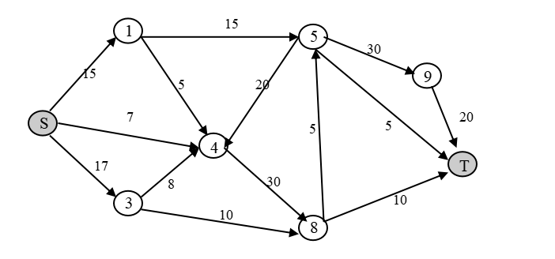

# 算法分析与设计 作业题目整理

> 收录本课程三次书面作业的全部题目：`作业一.docx`、`作业2.docx`、`作业34.docx`。
> 原文档中为图片/公式的内容已转录（公式以 LaTeX 排版，图以图片呈现）。

---

## 作业一（Assignment 1）

**1. 将下列函数按增长率的渐进阶从低到高排列（Arrange the following functions in ascending asymptotic order of growth rate）：**

$$f_1(n) = n^{2.5} - 3n + 5^{100}$$

$$f_2(n) = 2^{\log n \cdot \log \log n}$$

$$f_3(n) = \sqrt{n^{3.5}}$$

$$f_4(n) = 2^{2n}$$

$$f_5(n) = 3^n$$

**2. 贪心找零问题**：给定币种面值 1, 5, 10, 25, 100（分），设计一种用**最少硬币数**向顾客支付金额 x 的方法。
（Given currency denominations: 1, 5, 10, 25, 100, devise a method to pay amount x to customer using fewest number of coins.）

**3. 递归式求解（主定理）**：某算法将规模为 n 的问题分解为 **3 个**规模为 n/2 的子问题，递归求解各子问题，然后用 $n^2$ 时间合并各子问题的解。请分析该算法的运行时间。
（An algorithm solves problems of size n by dividing it into three subproblems of size n/2, recursively solving each subproblem, and then combining the solutions in $n^2$ time. Can you analyze the running time of this algorithm?）

**4. 动态规划解 0-1 背包**：给定 7 个物品和一个背包，物品 i 的重量 $w_i > 0$（千克）、价值 $v_i > 0$（美元）如下表。背包容量为 **14 千克**。如何装包使总价值最大？（要求用动态规划求解。）

| 物品 Items | 重量 Weight | 价值 Value |
|:---:|:---:|:---:|
| 1 | 3 | 2 |
| 2 | 4 | 3 |
| 3 | 2 | 3 |
| 4 | 2 | 1 |
| 5 | 7 | 6 |
| 6 | 5 | 3 |
| 7 | 6 | 5 |

*（Table 1，作业一原表）*

---

## 作业二（Assignment 2）

**1. 最小 s-t 割**：求下图（有向图，边上的数字为该边的**容量**）的最小 s-t 割。要求**给出计算步骤**（Ford-Fulkerson 各次增广），并**指出割的大小**。
（Find a minimum s-t cut in the following directed graph. You are required to give the computation steps and show the size of the cut.）

图的边与容量列表（便于演算）：

| 边 (u → v) | 容量 c(e) |
|:---:|:---:|
| S → 1 | 15 |
| S → 3 | 17 |
| S → 4 | 7 |
| 1 → 4 | 5 |
| 1 → 5 | 15 |
| 3 → 4 | 8 |
| 3 → 8 | 10 |
| 4 → 5 | 20 |
| 4 → 8 | 30 |
| 5 → 9 | 30 |
| 5 → T | 5 |
| 8 → 5 | 5 |
| 8 → T | 10 |
| 9 → T | 20 |

---

## 作业三、四（Assignments 3 and 4）

**1. 回答下列问题（Please answer the following questions）：**

- (a) 什么是多项式规约（polynomial reduction）？
- (b) P、NP 与 EXP 之间的关系是什么？（What is the relation among P, NP and EXP?）
- (c) 证明一个问题是 NP-完全的**主要步骤**是什么？

**2. 用"从最大独立集规约"的方法证明最大团问题的 NP-完全性。**
（Please prove the NP-completeness of the maximum clique problem by reducing from the maximum independent set.）
*说明：最大团问题给定一个图，要求找出一个最大的子图使得它是完全图（a maximum subgraph that is a complete graph）。*

**3. 证明：如果我们能在多项式时间内**判定**一个图是否有大小为 k 的顶点覆盖，那么我们也能在多项式时间内**找出**一个大小为 k 的顶点覆盖。**
（Please prove that if we can check if a graph has a vertex cover of size k in polynomial time then we can also find a vertex cover of size k in polynomial time.）
*（考点：自可规约性 self-reducibility，判定问题 vs 搜索问题。）*

**4. 证明：在图中找最长路径是 NP-难的（用从哈密顿圈问题的规约）。**
（Please prove that it is NP-hard to find a longest path in a graph, by reducing from the Hamiltonian cycle problem.）

**5.（中文题）对第五章 5.1 节 PPT 中介绍的 Load Balancing（负载均衡）问题设计一个近似算法，并证明该算法的近似率与运行时间。**
*（对应知识点：List-Scheduling 贪心是 2-近似，Graham 1966；LPT 规则是 3/2-近似，可任选其一设计并证明。）*

---

## 题目—知识点对照表（复习索引）

| 作业 | 题号 | 对应知识点（见知识点整理） |
|:---:|:---:|---|
| 一 | 1 | §2.2 渐进分析：多项式/指数/对数比较，$2^{\log n\log\log n} = n^{\log\log n}$ 的位置 |
| 一 | 2 | §4.3 贪心找零（对该币制贪心最优，需说明策略） |
| 一 | 3 | §7.3 主方法：$T(n) = 3T(n/2) + n^2$，$\log_2 3 < 2$，情形 3 ⟹ $\Theta(n^2)$ |
| 一 | 4 | §6.3 0-1 背包 DP：$M[i,w] = \max\{M[i-1,w],\ v_i + M[i-1,w-w_i]\}$，填 8×15 表并回溯 |
| 二 | 1 | §8 最大流：Ford-Fulkerson 增广步骤 + 最小割证书（流值 = 割容量） |
| 三四 | 1 | §9.5–9.6 P/NP/EXP、NP-完全证明配方三步 |
| 三四 | 2 | §9.3 规约策略（提示：与 §9.8 的 Clique/VC 等价规约互补：IND-SET ≤_P CLIQUE 取补图） |
| 三四 | 3 | §9.4 自可规约性（逐点试探 + 判定预言机） |
| 三四 | 4 | §9.7 HAM-CYCLE ≤_P LONGEST-PATH（路径长 ≥ n−1） |
| 三四 | 5 | §10.3 负载均衡：下界 $L^* \ge \max_j t_j$、$L^* \ge \frac{1}{m}\sum_j t_j$ + 2-近似证明 |
