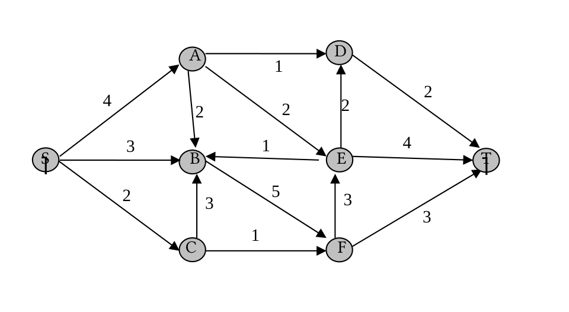
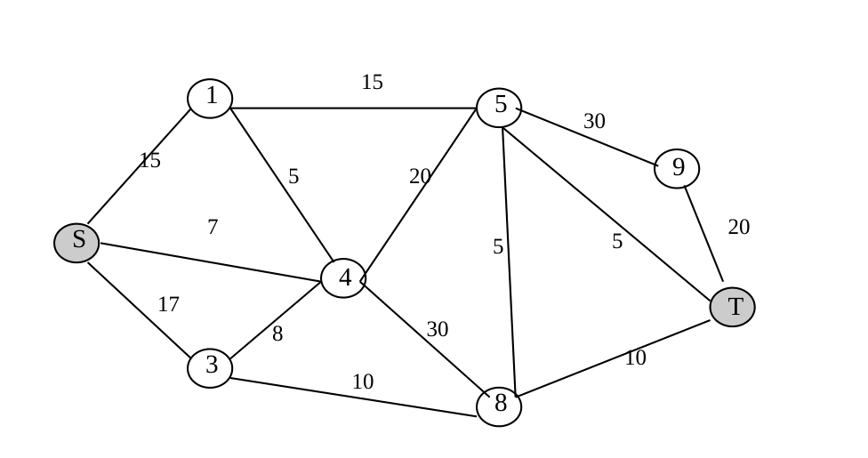
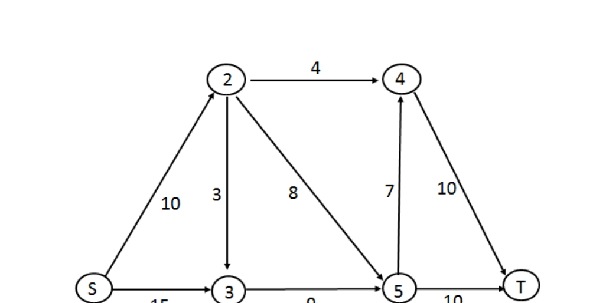
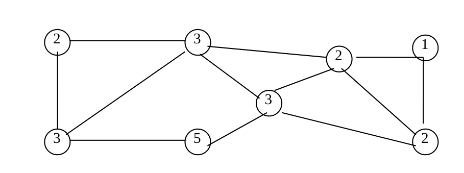
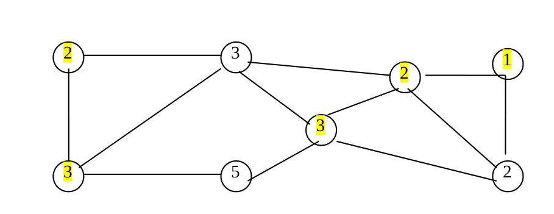

# 算法分析与设计 · 复习思路与题目对照总纲（含原题）

> 这份是**复习导航 + 自足练习册**：每个知识块内，**题目原封不动照录**，题下附解析与答案，不用来回翻文档即可刷题。
> 配套文档：《算法分析与设计-知识点整理.md》（§1–§10 知识字典）、《电子科技大学-算法设计与分析-往年考题整理.md》（按试卷排布的题库）、《算法分析与设计-题型分类与解题思路.md》（更详细的逐题解析）、《算法分析与设计-作业题目整理.md》（作业原题）。
>
> 出处缩写：春=2018春｜秋=2018秋｜英=英文卷｜A=中文卷A（注明v2差异）｜B=中文卷B｜拟=2019拟题｜模=模拟题｜2023=回忆版｜作=作业。

---

## 〇、考试画像（5 分钟）

| 板块 | 分值 | 对应复习块 |
|---|---|:---:|
| 判断题 10~15 题 | 20~30 分 | 各块陷阱清单 |
| 计算小题 3~7 题 | ≈24 分 | 块 9 |
| 函数增长率排序 ×1 | 6~8 分 | 块 1 |
| 递归式/分治分析 ×1 | 6~8 分 | 块 2 |
| 最大流/最小割 ×1 | 7~9 分 | 块 5 |
| 动态规划大题 ×1 | 10~15 分 | 块 4 |
| 自身规约证明 ×1 | 6~8 分 | 块 7 |
| NPC·NP-难证明 ×1 | 5~10 分 | 块 6 |
| 近似算法 / IP ×1 | 5~12 分 | 块 8 |
| 选做背诵题 | 4~6 分 | 块 10 |

**结论**：≈70% 分值来自固定套路。复习 = 三轮：①知识打底（30%）→ ②按下面十个块刷题（45%）→ ③整卷限时模拟（20%）→ 考前默写第五部分清单（5%）。只有一天时间直接跳第四部分。

---

## 块 1：渐进分析（★★★）

**复习要点**：§2.2。万能阶梯：Θ(1) < Θ(logᵏn) < Θ(n^ε) < Θ(n^c) < Θ(cⁿ) < Θ(n!) < Θ(nⁿ)；三易错：(log n)^a ≪ n^ε；(log n)^{log log n} 居中；n! > cⁿ > n^c。

### ▢ 题 1.1【春·三】8 分

> 将下列 5 个函数按渐近增长率由低到高排序，要求写出比较过程（各 log 底数为 2）：
> f₁(n)=n(log n)ⁿ，f₂(n)=2^{log log n}，f₃(n)=(log n)⁵，f₄(n)=∛n，f₅(n)=¹⁰√n·(log n)⁵⁰。

**解析**：f₃=Θ((log n)⁵)；f₂=(log n)^{log log n}（log log n→∞ 但 ≪ 常数倍 log n ⟹ 快于一切 (log n)^k、慢于一切 n^ε）；f₅=Θ(n^{0.1}(log n)⁵⁰)；f₄=Θ(n^{1/3})；f₁ 超多项式。比较：f₃<f₂（log log n 终超 5）；f₂<f₅；f₄/f₅=n^{7/30}/(log n)⁵⁰→∞ ⟹ f₅<f₄；f₄<f₁。
**答案**：f₃ < f₂ < f₅ < f₄ < f₁。

### ▢ 题 1.2【秋·三】8 分

> 排序：f₁=√n+(log n)^100，f₂=2^{log n+log log n}，f₃=log(n¹⁰⁰×3ⁿ)，f₄=n²⁰⁰+3ⁿ，f₅=log(n^{100 log n})，f₆=100ⁿ+n!。
**解析**：f₁=Θ(√n)（√n 终压 (log n)^100）；f₂=n·log n；f₃=100log n+n·log3=Θ(n)；f₄=Θ(3ⁿ)；f₅=100log²n=Θ(log²n)；f₆=Θ(n!)。
**答案**：f₅ < f₁ < f₃ < f₂ < f₄ < f₆（每错一个扣 1 分，无依据扣 2 分）。

### ▢ 题 1.3【A·三】7 分

> f₁=2014n⁶+5n⁴，f₂=n²⁰¹⁴+3ⁿ，f₃=【上标丢失，疑为 2014ⁿ】，f₄=log n+(2014log n)³，f₅=2ⁿ+n!+5ⁿ，f₆=3log(2n)+log log n，f₇=2ⁿlog n+logⁿn。
**解析**：f₁=Θ(n⁶)；f₂=Θ(3ⁿ)；f₄=Θ((log n)³)；f₅=Θ(n!)；f₆=Θ(log n)；f₇=Θ(nⁿ)。
**答案**：f₄ < f₆ < f₃ < f₁ < f₂ < f₅ < f₇。

### ▢ 题 1.4【英·二】6 分（公式缺失）／【B·三】6 分（f₂–f₄ 缺）

> 英卷答案：f₂, f₃, f₁, f₄, f₅；B 卷答案：f₆ < f₅ < f₄ < f₁ < f₂ < f₃ = f₇（其中 f₆=100log(2n)+log¹⁰⁰log n=Θ(log n·polylog)、f₅=2015=Θ(1)）。
**解析**：方法同上——先化简定阶再套阶梯。

### ▢ 题 1.5 判断题两道

> 【春·一.3】存在 f,g 使 f=Ω(g) 且 f=O(g)，但不存在使 f=ω(g) 且 f=o(g) 同时成立。（　）
> 【秋·一.7】旧算法 O(n³)、新算法 O(n²)，则运行时间改进了 O(n)。（　）

**解析**：前者 T——Ω∩O=Θ（例 f=g=n）；ω∩o=∅（矛盾）。后者 F——渐进记号之差无意义，只能说渐近更快。

---

## 块 2：递归式与分治（★★★）

**复习要点**：§7 主定理三情形；两变体——子问题规模不等（n/3 与 2n/3 ⟹ Θ(n log n)）、规模减常数（3T(n−1)+1 ⟹ Θ(3ⁿ)）。

### ▢ 题 2.1【秋·五】6 分

> 对输入规模 n 的问题有三个分治算法：
> （1）分成 5 个子问题，每个 n/5，合并需 O(n²)；
> （2）分成 4 个子问题，每个 n/2，合并需 O(n)；
> （3）分成 2 个子问题（n/3 与 2n/3），合并需 O(n)。
> 请分析以上 3 个算法的运行时间。

**解析**：(1) n^{log₅5}=n，f=n² 多项式大 ⟹ 情形 3 ⟹ Θ(n²)；(2) n^{log₂4}=n²，f=n 多项式小 ⟹ 情形 1 ⟹ **Θ(n²)**（不是 n²log n）；(3) 规模不等：每层合计 ≤cn、深 O(log n) ⟹ Θ(n log n)。
**答案**：O(n²)、O(n²)、O(n log n)。

### ▢ 题 2.2【A·五】8 分

> （1）2 个子问题（n/3），合并 O(n)；（2）3 个子问题（n/2），合并 O(n)；（3）4 个子问题（n/2），合并 O(n²)；（4）3 个子问题（n−1），合并 O(1)。

**解析**：(1) n^{log₃2}≈n^0.63，f=n 大 ⟹ Θ(n)；(2) n^{log₂3}，f=n 小 ⟹ Θ(n^{log₂3})；(3) n² 同阶 ⟹ Θ(n²log n)；(4) 展开 3ⁿ 叶 ⟹ Θ(3ⁿ)。
**答案**：O(n)、O(n^{log₂3})、O(n²log n)、O(3ⁿ)。

### ▢ 题 2.3【B·六】7 分

> （1）4 个子问题（n/4），合并 O(n²)；（2）3 个子问题（n/2），合并 O(n)；（3）2 个子问题（n/3 与 2n/3），合并 O(n)。

**答案**：O(n²)、O(n^{log₂3})、O(n log n)。

### ▢ 题 2.4【春·五】10 分

> 排序的三种分治策略：算法1 分 2 个 n/2；算法2 分 3 个 n/3；算法3 分 4 个 n/4（取整），合并均线性。
> 问题 1：设计一个线性时间算法将**四个**已排序数列合并成一个有序数列。（4 分）
> 问题 2：分析三个算法的运行时间。（6 分）

**解析**：三个均为 aT(n/a)+Θ(n) ⟹ 情形 2 ⟹ **均 Θ(n log n)**。4 路合并：两轮两两归并：(L₁,L₂)→M₁，(L₃,L₄)→M₂ 各 O(n)，再 M₁+M₂→L O(n) ⟹ 线性 ✓。

### ▢ 题 2.5【作·一.3】（作业原题）

> 某算法把规模 n 的问题分成 3 个规模 n/2 的子问题，递归求解后用 n² 时间合并。分析运行时间。
**解析**：T=3T(n/2)+n²，n^{log₂3}≈n^1.585，f=n² 多项式大且满足正则条件 ⟹ 情形 3 ⟹ **Θ(n²)**。

---

## 块 3：贪心算法（★★★）

**复习要点**：§4.2 区间调度（按结束时间贪心+交换论证）、§4.5 区间划分（深度下界）、找零贪心、贪心反例构造。

### ▢ 题 3.1【A·二.3】3 分

> 区间段 (0,3), (2,4), (3,6), (5,7), (1,4), (3,5), (6,8), (7,9)，找出个数最多的一组相容区间段（交集为空）。
**解析**：按结束时间贪心：(0,3)→(3,5)→(5,7)→(7,9)。
**答案**：(0,3), (3,5), (5,7), (7,9)。

### ▢ 题 3.2【春·二.2】4 分

> 区间段 (-3,0], (0,3], (1,4], (-2,1], (3,5], (0,4], (2,6], (-1,2]，找出个数最多的一组相容区间段。
**解析**：按结束时间排序后贪心：(-3,0] → (0,3]（0 为开端点，交空）→ (3,5]；此后无相容者。
**答案**：{(-3,0], (0,3], (3,5]}，共 3 个。

### ▢ 题 3.3【B·四】8 分

> n 个讲座安排最少教室（结束时间=开始时间也算交叉）。实例：[9,10], [9,11], [11,13], [11,12], [12,14], [9,12], [17,18], [14,15], [13,15], [10,13], [15,17]。
**解析**：下界 = 深度。逐时刻扫描（s 处 +1、t 处减 1，端点相接先加后减）：t=9→3，t=10→4，t=11→5，t=12→5，t=13→5，之后下降。深度=5 ⟹ 至少 5 间；按开始时间贪心恰用 5 间。
**答案**：最少 **5 个教室**（思路 2-3 分、过程 2-3 分、结果 2 分）。

### ▢ 题 3.4【英·五】6 分

> Design an algorithm for Interval Scheduling（n jobs，start s/finish f，不重叠为相容，求最大相容集）。
**解析（卷面答案）**：按完成时间先后排序（2 分）；依次选取最小完成时间且和已选工作不冲突的工作（4 分，未说明不冲突扣 1 分）。最优性：交换论证（§4.2）。

### ▢ 题 3.5【作·一.2】（作业原题）

> 币值 1, 5, 10, 25, 100，设计用最少硬币支付金额 x 的方法。
**解析**：贪心——每次取不超过剩余金额的最大面值（34¢=25+5+4×1）。该币制下贪心最优；注意贪心最优依赖币制（US postal 反例：140¢ 贪心 8 枚 vs 最优 70+70 共 2 枚）。

### ▢ 题 3.6【春·二.6】6 分

> 贪心求最小点覆盖（取度数最大点入解并删除其关联边）：构造例子说明 (1) 找不到最优解；(2) 不是 1.5 倍近似算法。
**解析**：(1) 三角形 abc + 点 d 仅邻 a：度 a=3 最大，贪心选 a ⟹ 删光 ⟹ 解大小 1；最优 {b,c}=2 ⟹ 非最优。(2) 皇冠图 K_{k,k} 减去完美匹配（k≥4）：最优=k（一侧全点）；贪心取一点后剩星形，再取中心 ⟹ 贪心=2，比值 k/2=2>1.5。∎

### ▢ 题 3.7【A·四】8 分

> 四种运货车：推车最小 < 小货车(=2×推车) < 中货车(=2×小+1×推) < 大货车(=1×中+1×小+2×推)，数量充足，除推车外须装满才发车。设计最少辆车方案并证明正确性。
**解析**：贪心——按容量大→小，能装满大车先装满发车。证明（交换论证）：设贪心解 a₁..a₄、最优 b₁..b₄，取最大差异位 i，用等量兑换把最优解换成贪心解（2 中+1 推 类组合换 1 大 等），车辆数不减 ⟹ 贪心最优。

### ▢ 题 3.8【B·九】6 分

> 设计一个快速算法求**树上**最小点覆盖。
**解析**：贪心：不断取与叶子相邻的点加入覆盖，删该点及相邻所有点；O(n)。正确性：叶子边的覆盖选父不劣（u 还覆盖其它边）——交换论证。指数时间算法扣 3-4 分，无分析扣 1-2 分。

---

## 块 4：动态规划（★★★，大题来源）

**复习要点**：§6 五步模板（子问题→递归式→边界→填表→回溯）；四大例 LCS/矩阵链/背包/子集和；伪多项式。

### ▢ 题 4.1【春·八】10 分

> 用 DP 求两字符序列最长公共子序列，实例 **X=ATCGATGC，Y=AATGATCC**，给出计算过程。
**解析**：c[i][j]：相等 c[i−1][j−1]+1，否则 max(c[i−1][j], c[i][j−1])；边界 0。填 9×9 表（见题型分类文档完整表），c[8][8]=6，回溯得 **ATGATC**。
**答案**：LCS=**ATGATC**，长 6，Θ(mn)。

### ▢ 题 4.2【B·五】10 分

> 对实例 **aacbdac** 和 **dacdbac** 画表求 LCS。
**答案**：**acbac**（长 5）。评分：子问题 2 分+递归式 4 分（边界 1 分）+表 3 分+结果 1 分。

### ▢ 题 4.3【秋·八】14 分

> 矩阵连乘：A₁(12×15), A₂(15×8), A₃(8×20), A₄(20×10), A₅(10×16)。(1) 设计 DP 给子问题定义与递归式；(2) 画表并给最优加括号方式。
**解析**：m[i][j]=min_{i≤k<j}{m[i,k]+m[k+1,j]+p_{i−1}p_kp_j}，m[i,i]=0；按链长填表 + 分割点 s 表。s(1,5)=2、s(3,5)=4。验算：1440+1600+1280+1536=5856。
**答案**：**((A₁A₂)((A₃A₄)A₅))**，最少 **5856** 次；O(n³)。

### ▢ 题 4.4【作·一.4】（作业原题）

> 7 物品（w: 3,4,2,2,7,5,6；v: 2,3,3,1,6,3,5），容量 14 kg，DP 求最大价值。
**解析**：M[i][w]=max(M[i−1][w], M[i−1][w−wᵢ]+vᵢ)；填 8×15 表。最优组合 {3,5,6}（w=14，v=12）或 {2,3,4,7}（w=14，v=12）。
**答案**：最大价值 **12**；Θ(nW) 伪多项式。

### ▢ 题 4.5【英·十二】15 分

> 5 种物品**每种两件**（w: 1,2,4,3,5；v: 2,3,8,2,9），容量 10。(a) 子问题；(b) 递归式；(c) 画表求解。
**解析**：(a) OPT(i,w)=前 i 种、容量 w 的最优；(b) **三选一**（0/1/2 件）：OPT(i,w)=max{OPT(i−1,w), OPT(i−1,w−wᵢ)+vᵢ, OPT(i−1,w−2wᵢ)+2vᵢ}（不可行舍弃）；(c) 填 6×11 表回溯。
**答案**：**20 = 2 件物品3 + 2 件物品1**（w=10）。注意：按普通背包做总分基数降为 10 分。

### ▢ 题 4.6【A·十一(一)】10 分

> 子集和：A={1,2,5,6,7}，k=11，DP 画表求解。
**解析**：可达性 DP：OPT(i,s)=OPT(i−1,s) ∨ OPT(i−1,s−aᵢ)，OPT(0,0)=1。
**答案**：**Yes，{5,6}**。（模拟题 A={2,3,7,8,9}, k=18 ⟹ {9,7,2} 或 {8,7,3}）

### ▢ 题 4.7【2023】

> (1) 网格从 (0,0) 到 (n,m) 捡最大金币并给出路径；(2) 说明斐波那契数列的 DP 是否为多项式时间算法。
**解析**：(1) f[i][j]=max(f[i−1][j], f[i][j−1])+w[i][j]，回溯路径；(2) O(n) 是关于**数值** n 的，输入 log n 位 ⟹ **伪多项式**，非严格多项式。

### ▢ 题 4.8【英·三(a)】3 分

> What are the main steps of designing a dynamic programming algorithm?
**答案（背诵）**：1. 定义子问题；2. 根据子问题建立递归关系式；3. 自底向上求解（建立存储表）。（每步 1 分）

---

## 块 5：最大流与最小割（★★★，每卷必考）

**复习要点**：§8。三件套：①声明"转最大流用 FF"→②逐条增广路（路径+瓶颈）→③无增广路后取残量可达集为割，验算 流值=割容量。割容量只算 A→B 方向边。

### ▢ 题 5.1【春·四】8 分

> 求 S 到 T 间的最大流，要求给出最少两个中间计算步骤。

边表：S→A:4，S→B:3，S→C:2，A→D:1，A→B:2，A→E:2，E→B:1，E→D:2，D→T:2，E→T:4，B→F:5，C→B:3，C→F:1，F→E:3，F→T:3。
**解析**：①S→A→E→T +2；②S→A→D→T +1；③S→B→F→T +3；④S→C→F→E→T +1；⑤S→C→B→F→E→T +1；⑥S→A→B→F→E→D→T +1。此后 S 三条出边全饱和，无增广路。守恒验算通过（T 收 2+4+3=9）。
**答案**：**最大流 = 9**（最小割 {S}｜其余，容量 4+3+2=9）。

### ▢ 题 5.2【英·六】9 分（=作业二第 1 题）

> Find a minimum s-t cut, give the computation steps and show the size of the cut.

边表：S→1:15，S→3:17，S→4:7，1→4:5，1→5:15，3→4:8，3→8:10，4→5:20，4→8:30，5→9:30，5→T:5，8→5:5，8→T:10，9→T:20。
**解析**：①S→3→8→T +10（8→T 饱和）；②S→1→5→9→T +15（S→1 饱和）；③S→4→5→T +5（5→T 饱和）；④S→3→4→5→9→T +5（9→T 饱和）。T 三条入边全饱和 ⟹ 流 35。
**答案**：**最小割 = 35**，割为 {除 T 外全部点}｜{T}（另一最优割 {S,4,3,8} 亦可）。

### ▢ 题 5.3【B·七】7 分

> 求图中 S 和 T 间的最小割，要求给出计算步骤。

边表：S→2:10，S→3:15，2→4:4，2→3:3，2→5:8，3→5:9，5→4:7，4→T:10，5→T:10。
**解析**：①S→2→4→T +4；②S→2→5→T +6（S→2 饱和）；③S→3→5→T +4；④S→3→5→4→T +5（3→5、5→T 饱和）。残量中 S 只能到 3，3→5 已饱和 ⟹ 可达集 {S,3}。
**答案**：**最小割 = 19**（割 {S,3}：S→2 10 + 3→5 9）。

### ▢ 题 5.4【秋·四】8 分【图缺失】

> 求有向图 s-t 最小割，给最少两个中间步骤。
**解析（原卷答案）**：增广 ①(s,u,t)+5；②(s,x,t)+5；③(s,v,w,t)+8；④(s,u,w,v,x,t)+3（借反向边）。
**答案**：**最小割 = 21**。

### ▢ 题 5.5【A·六】8 分【图缺失】

> 求 S-T 最小割。
**答案**：**16**，割 [{S,A,B,C,D,E}, T]。

### ▢ 题 5.6 纠错三连

> 【秋·二.4A】（4 分）两对顶点 (s₁,t₁)、(s₂,t₂) 最大流：加 super-source s（∞ 连 s₁,s₂）、super-sink t（∞ 连 t₁,t₂），求 s-t 最大流。分析正确性。
> 【B·二.5】（4 分）两对顶点最小割的同类算法。
> 【拟·二.2】（4 分）x 对顶点同时最大流的同类算法。
**解析**：三者**都错误**——super-source/sink 会让流"交叉配对"：s₁ 的流可到 t₂、s₂ 可到 t₁（B 卷版本：割会把 s₁–t₂ 也割断，超出原问题需要）。（判断 2 分 + 理由 2 分）

---

## 块 6：NP、NPC 与规约（★★★，证明题来源）

**复习要点**：§9。三步配方（∈NP → 选已知 NPC 源 → 构造 + iff 双向）；规约工具箱：加叶、加三角、补图、权 1-2、阈值 n−1、2 度点。

### ▢ 题 6.1【作·三四.1】（作业原题）

> (a) 什么是多项式规约？(b) P、NP、EXP 的关系？(c) 证明 NPC 的主要步骤？
**解析**：(a) X≤pY：任意 X 实例可只用多项式步数 + 多项式次 Y 神谕调用求解（Karp 版：一次变换 x↦y，x yes ⟺ y yes）；(b) P⊆NP⊆EXP（P⊆NP：证书取空串；NP⊆EXP：枚举所有多项式长证书）；(c) 三步配方。

### ▢ 题 6.2【春·二.4】6 分 / 【英·三(b)】3 分

> 写出证明一个问题是 NPC 的基本步骤，并给出最少三个著名 NPC 问题的名字。
**答案（背诵）**：①证 ∈NP（证书+多项式验证器）；②选已知 NPC 问题 X；③证 X≤p 该问题。著名 NPC：3-SAT、顶点覆盖、哈密尔顿圈（或 TSP、3-着色、子集和、团、独立集、集合覆盖）。

### ▢ 题 6.3【秋·七】10 分

> 给出图和整数 k，问能否**删除 k 个点使剩余图上没有三角形**。证明 NP 完全。
**解析**：①∈NP：证书=删的 k 点，验证无三角形多项式；②源=点覆盖；③构造：G 每条边 ab 加点 c 连成 △abc 得 G′，k 不变。(⟹) 覆盖击中每个三角形至少一点 ⟹ 删后无三角；(⟸) 可设删的全是原点（删 c 换删其邻居不劣）⟹ 每条边至少一端被删 ⟹ 是点覆盖。∎（源 2 分+构造 4 分+iff 3 分）

### ▢ 题 6.4【拟·五】8 分

> 证明独立集问题（是否存在大小 k 的独立集）是 NP 完全的。
**解析**：①∈NP：证书 k 点，验证两两无边 O(k²)；②源=点覆盖；③(G,k) ⟼ (G, n−k)：S 独立 ⟺ V−S 覆盖（每边至少一端∉S ⟺ 至少一端∈V−S）。双向各一句话。∎

### ▢ 题 6.5【A·十】5 分（v1 / v2 两版）

> v1：说说**支配集**（V−S 每点与 S 某点相邻）和点覆盖的差别，证明支配集 NP 难。
> v2：**独立匹配**（边两两无公共端点且不同边端点间无边）最大化是 NP 难。
**解析 v1**：区别举例（支配集管"点"覆盖管"边"）；规约：G 每点 v 加叶 v′ 得 G′，k 不变。叶 v′ 只能被 v 或自身支配 ⟹ 可换为父 ⟹ 每叶被支配 ⟹ 全部父入选 ⟹ 是 G 的点覆盖；反向：点覆盖支配所有叶与其余点。
**解析 v2**：从独立集规约：G 每点 v 加新点 v′ 仅邻 v 得 H。G 独立集 S ⟹ {vv′: v∈S} 是 H 的独立匹配；H 独立匹配 ⟹ 其 G 侧端点是 G 的独立集（否则不同边的端点间有边，违约）。∎

### ▢ 题 6.6【B·十】6 分

> **P₃-覆盖**（每条 3 顶点路径至少一点在 A 中）最小化是 NP 难。
**解析**：从点覆盖规约：G 每点 v 加叶 v₁ 只邻 v 得 G₁。(⟹) 覆盖 C 击中每条 P₃（含叶的路径 v₁–v–u 中边 v₁v 被覆盖）；(⟸) 叶可换为其父 ⟹ 每条 G 的边 uv 的 P₃（u–v–w）被 A 击中 ⟹ uv 至少一端∈A ⟹ 点覆盖。∎

### ▢ 题 6.7【2023】边支配集 NPC

**解析**：边 e 支配 f ⟺ 共享端点或相同。①∈NP；②从点覆盖：G 每条边 uv 加新点 x_e 仅邻 u,v 得 G′。(⟹) 覆盖 {v₁..v_k} 各选一条关联边作 EDS——G′ 任何边与某选中边共享端点；(⟸) EDS 的 G 侧端点命中所有原边 ⟹ 点覆盖。∎

### ▢ 题 6.8【英·八】6 分

> Constrained Hamiltonian Cycle（须经过给定边）→ Hamiltonian Cycle 的规约。
**解析**：每条须经过的边 uv 插入 2 度新点 w：删 uv，连 u–w–v。圈过 w 必走 u–w–v ⟹ 圈通过该边；双向展开/收缩即 iff。∎

### ▢ 题 6.9【英·十一】8 分

> 给出 VC→IS 与 IS→Clique 的多项式规约。
**解析**：VC→IS：(G,k)⟼(G, n−k)，S 覆盖 ⟺ V−S 独立；IS→Clique：(G,k)⟼(Ḡ,k)，G 的独立集 ⟺ Ḡ 的团。（各 4 分）

### ▢ 题 6.10【作·三四.2 / 作·三四.4】（作业原题）

> 用从最大独立集规约证明**最大团** NP-完全；从哈密顿圈规约证明**最长路径** NP-难。
**解析**：团：∈NP；IS⟼(Ḡ,k)，G 的团 ⟺ Ḡ 的独立集。最长路：∈NP；HAM⟼问长 ≥ n−1 的简单路径（有 ⟺ 有哈密尔顿路径/圈，按题面构造）。

### ▢ 题 6.11【春·七】6 分

> 证明：路径长 **<k** 判定 ∈P；路径长 **>k** 判定 ∈NP。
**解析**：<k：BFS/Dijkstra 求最短路 d，判 d<k，多项式 ⟹ ∈P；>k：证书=那条路径（≤n−1 边），验证简单性+长度多项式 ⟹ ∈NP。

### ▢ 题 6.12【拟·七】8 分

> 证明二着色问题 ∈P。
**解析**：二可着色 ⟺ 无奇圈。BFS 交替染色，遇相邻同色即有奇圈输出"否"；O(V+E) ⟹ ∈P。

---

## 块 7：判定→搜索：自身规约（★★★，每卷必考）

**复习要点**：§9.4。口诀：**覆盖/团/支配集按点删，路径/圈按边删，着色加边或并点**。

### ▢ 题 7.1【作·三四.3】（作业原题）

> 若能在多项式时间**判定**图中是否有大小 k 的顶点覆盖，则也能多项式时间**找出**一个。
**解析**：先求最小基数 k*（递减问 A）；对每点 v 问 A(G−v, k*−1)：是 ⟹ 真删 v；否 ⟹ v 入解集并删 v 及关联边。n 次调用多项式 ⟹ 找到解。

### ▢ 题 7.2【春·六】6 分

> 判定"大小 k 完全子图"存在 ⟹ 可找到。
**解析**：按点删：对每个 v 问 A(G−v,k)：是 ⟹ 真删；否 ⟹ v 保留（必在某 k-团中）并删其所有非邻居。n 次后剩 k 点两两相邻。

### ▢ 题 7.3【英·七】/【A·七】6 分

> 判定"长 k 路径"存在 ⟹ 可找到（或证明不存在）。
**解析（原卷标准答案）**：按**边**删：先问 A(G,k)，否则返回不存在；对每条边 e：删后 A 仍"是"⟹ 真删；"否"⟹ 保留。测完所有边剩 k 条边即路径。（答删点版给 4-5 分；其它最多 3 分。）

### ▢ 题 7.4【B·八】6 分

> 判定 k-完全子图 ⟹ 找到或证明不存在。
**解析**：同 7.2，先问一次 A 处理"不存在"分支。

### ▢ 题 7.5【秋·六】8 分

> 判定可三着色 ⟹ 找到具体三着色。
**解析（原卷两解法）**：①**加边**：反复加新边调 A，仍可着色则保留，不可则撤销并记录两端异色；无法再加时图分成 3 个团=3 个独立集，各染一色。②**并点**：反复合并不相邻两点调 A，可行则真合并；剩 3 个超点即三色。（思想正确给全分；得不到解的方法扣 4-6 分。）

---

## 块 8：近似算法与整数规划（★★）

**复习要点**：§10。三段式（算法→下界→比值）；竞价法+公平价格引理；负载均衡两下界；IP 口诀"覆盖≥1、独立≤1、团=补图独立集"。

### ▢ 题 8.1 竞价法（同一题考 4 次：秋·二.3A / A·八 / B·二.7 / 拟·四，另春·二.3A）

> 叙述带权点覆盖问题的竞价法（Pricing Method）步骤，并证明它是 2 倍近似算法。
**解析（全背）**：
1. **叙述**：pₑ 从 0 起；while 存在边 i-j 两端都不**紧**（点紧 ⟺ 关联边价格和 = wᵢ）：选该边抬高 pₑ 至一端变紧；结束取全部紧点 S。
2. **S 是覆盖**：否则有边两端不紧 ⟹ 循环未停，矛盾；
3. **2-近似**：公平价格引理 Σₑpₑ ≤ w(S*)（任意覆盖成立）；w(S)=Σ_{i∈S}Σ_{e∋i}pₑ ≤ Σₑ2pₑ（每边至多 2 紧端点）= 2Σₑpₑ ≤ 2w(S*)。∎
（叙述 5 分 + 证明 3 分。）

### ▢ 题 8.2【秋·二.2】4 分 /【作·三四.5】

> 负载均衡：任务按任意次序依次放到当前最轻机器。证明 2-近似（作业题：设计近似算法并证近似率与运行时间）。
**解析**：下界 L*≥max tⱼ 且 L*≥(1/m)Σtⱼ；瓶颈机 i 上最后任务 j：放入时 Lᵢ−tⱼ≤Lₖ ∀k ⟹ 求和除 m：Lᵢ ≤ tⱼ+(1/m)Σtⱼ ≤ max tⱼ + L* ≤ **2L***。∎（优先队列实现 O(n log m)。LPT 版：降序后再列表调度，鸽笼 L*≥2t_{m+1} ⟹ 3/2-近似。）

### ▢ 题 8.3【英·十】8 分

> m 台机器、2m+1 个任务（m+1..2m 各 2 件、m 一件）。(a) LPT 近似解；(b) 最优解。
**解析**：(a) LPT=降序+每次放当前最长任务到当前最轻机器；(b) 总量 3m²+2m 均摊 (3m²+2m)/m=**3m+2**；可达：m−1 台各配 (m+1+j)+(2m−j) 类对子，最后一台 (m+1)+(m+1)+m。

### ▢ 题 8.4【英·九】12 分

> 带权点覆盖：(a) IP 形式；(b) 基于 LP 的 2-近似；(c) 证明近似比 2。
**解析**：(a) min Σwᵢxᵢ s.t. 每边 xᵢ+xⱼ≥1，xᵢ∈{0,1}；(b) 松弛 0≤xᵢ≤1 解 LP，取 xᵢ*≥½ 的点；(c) 覆盖性：每边至少一端≥½；权值 w(S)≤Σ2wᵢxᵢ*=2LP*≤2OPT。∎

### ▢ 题 8.5【A·九】5 分

> 为最大团（v1）/ 最大独立集（v2）建整数规划模型。
**解析（独立集）**：max Σxᵢ s.t. 每边 xᵢ+xⱼ≤1，xᵢ∈{0,1}。最大团：转补图独立集（对每对**非边** xᵢ+xⱼ≤1；或先转 IS 再建模，原卷给 4-5 分；直接写 IS 模型给 3 分）。

### ▢ 题 8.6【2023】匹配 1/2-近似

> 最大独立边集（边两两无公共端点）。设计 1/2 近似并证明。
**解析**：贪心任取一边入 M，删其两端点关联的所有边，重复。O 中每条边至多与 M 中一条边共享一个端点 ⟹ |O| ≤ 2|M| ⟹ |M| ≥ OPT/2。∎

---

## 块 9：手算杂项（★★，白送的分）

### ▢ 题 9.1 SAT 赋值

> 【春·二.1】$(\bar{x}_1 \lor \bar{x}_2 \lor x_4) \land (\bar{x}_1 \lor x_2 \lor x_3) \land (x_2 \lor \bar{x}_3 \lor x_4) \land (\bar{x}_2 \lor x_3 \lor \bar{x}_4)$ 是否有解？是否有 x₁=1 条件下的解？
**解析**：定 x₁=1 后 ①变 (x̄₂∨x₄)、②变 (x₂∨x₃)。取 x₂=0：①需 x₄=1，②需 x₃=1，③④自动满足。
**答案**：有解；x₁=1 条件下也有解：**x₁=1, x₂=0, x₃=1, x₄=1**。

> 【A·二.2】$(\bar{x}_1 \lor x_2 \lor x_3) \land (x_1 \lor \bar{x}_2 \lor x_3) \land (\bar{x}_1 \lor x_2 \lor x_3) \land (\bar{x}_1 \lor \bar{x}_2 \lor \bar{x}_3)$
**答案**：x₁=1, x₂=1, x₃=0（或 x₁=0, x₂=0, x₃=0；多解任给一种）。

> 【B·二.3】$(\bar{x}_1 \lor \bar{x}_2 \lor x_3) \land (x_1 \lor x_2 \lor x_4) \land (\bar{x}_1 \lor x_2 \lor x_3) \land (x_1 \lor \bar{x}_2 \lor \bar{x}_4)$
**答案**：有解，如 x₁=1, x₂=0, x₃=1, x₄=1。

> 【拟·二.3】存在**几组**成真赋值？【公式缺失】
**方法**：k≤4 时枚举 2ᵏ 组逐一验证再数。

### ▢ 题 9.2 逆序计数

> 【秋·二.1】序列 5,10,7,9,13,1,8,4,12,2,6,3,11,14 的逆序数。
**解析**：逐元素数右侧更小者：4,8,5,6,8,0,4,2,4,0,1,0,0,0。
**答案**：**42**。
> 【B·二.1】序列 4,6,3,7,12,1,9,2,7,10,5,11,8。
**答案**：**28**（3+4+2+3+8+0+4+0+1+2+0+1+0）。

### ▢ 题 9.3【B·二.4】3 分

> (23,45,17,9,20,29,5,24) 能否分成两组和相等？
**解析**：总 172，各 86；45+24+17=86 ✓。
**答案**：能：(17,24,45)｜(23,9,20,29,5)。

### ▢ 题 9.4【B·二.2】3 分

> 带权图求**最小点覆盖**的大小与方案。

**解析**：8 点小图：低权点舍弃+其邻居必选的推理，残余自由点枚举；可用对偶（总权−最大权独立集）互验。
**答案**：**11**，方案：

### ▢ 题 9.5【英·四】8 分

> TSP 最优巡回；含 A 的最长有向圈。（图见 assets/考题-不明1-TSP图.png；边权双向读：A-B:20, A-C:42, A-D:35, B-C:30, B-D:34, C-D:12）
**解析**：枚举 3 条哈密尔顿圈：A-B-C-D-A=97；A-B-D-C-A=108；A-C-B-D-A=141。
**答案**：(a) **97**（A→D→C→B→A）；(b) **141**（A→C→B→D→A）。

### ▢ 题 9.6【A·二.1】3 分

> 求有向图最长路径（边表：C→A:40，A→D:30，D→B:35，A→B:20，C→B:30，C→D:22）。
**解析**：枚举简单路径：C-A-D-B=105 最长。
**答案**：**CADB，105**。

### ▢ 题 9.7【春·二.5A】4 分

> 四皇后已给一解（各行放列 {2,4,1,3}），给另一个解。
**答案**：镜像解 **{3,1,4,2}**。

### ▢ 题 9.8【2023】

> 给定 4 顶点带权图求最短路及路径；给定图用 1,2,3 三色着色。
**方法**：小图肉眼枚举；着色按相邻异色逐点染。

---

## 块 10：稳定匹配 + 选做背诵（★）

**复习要点**：§3 Gale-Shapley（已收真题未考，按潜在考点准备）；选做背诵条目。

### ▢ 题 10.1【秋·二.3B】4 分

> 用数学表达式表示神经元数学模型并说明参数含义。
**答案**：X={1, x₁..x₄}，W={w₀..w₄}；**Y = f(X·W + b)**；Y 输出、f 激活函数、X 输入、W 连接权重、b 偏置。

### ▢ 题 10.2【秋·二.4B】4 分

> 简述并行算法 PCAM 设计方法学四步骤及性能指标。
**答案**：任务分解、通信设计、任务组合、处理器映射（各 0.5 分）；执行时间、效率与加速比、可扩展性（各 0.5 分）。

### ▢ 题 10.3【A·十二】6 分

> EREW PRAM 求第 3 小数；PCAM；人工神经网络；计算智能三领域。
**答案**：并行求最小→标记删除→再求→再求，O(log n) 时间、O(n) 工作；PCAM 同上；神经网络=适应性简单单元广泛并行互连的网络；三领域=神经计算、模糊计算、进化计算。

### ▢ 题 10.4 稳定匹配自测（潜在考点）

> 给任意 n 男 n 女偏好表手跑 Gale-Shapley；默写算法与其三证明（终止 ≤n² 次提议、完美性、稳定性），并说明"男性最优、女性最差"。
**复习**：知识点 §3 全节。

---

## 整卷限时模拟顺序

| 顺序 | 卷 | 说明 |
|:---:|---|---|
| 1 | 秋（带答案与评分标准） | 校准自评 |
| 2 | 春（无答案，用解析自评） | |
| 3 | 英 | 背包双件变式 |
| 4 | A | 运货车、支配集/独立匹配 |
| 5 | B | P₃-覆盖、树上点覆盖 |
| 6 | 拟 | 查漏 |

---

## 一日冲刺版

| 时段 | 内容 |
|---|---|
| 上午 1 | 默写：主定理+两变体｜NPC 三步配方+工具箱｜近似三段式+竞价法证明｜自身规约口诀 |
| 上午 2 | 重做 4 道必考：英·六最小割、秋·三排序、A·五递归式、秋·八矩阵链 |
| 下午 1 | 判断题陷阱清单 + 手算速练（SAT×2、逆序×1、区间×1） |
| 下午 2 | 限时重做作业一二三四全部原题（真题同源） |
| 晚上 | 抄写三个证明模板（竞价法/负载均衡/NPC 三步），睡前再默一次 |

---

## 考前必背清单

- [ ] 主定理三情形 + 两变体（不等规模 ⟹ n log n；T(n−1) ⟹ aⁿ）
- [ ] 万能阶梯 + 三易错对
- [ ] 最大流三件套（声明→增广→残量可达集为割）
- [ ] DP 五步 + 四个递归式 + 伪多项式一句话
- [ ] 自身规约口诀（按点/按边/加边并点）
- [ ] NPC 三步配方 + 8 条规约工具箱
- [ ] 竞价法叙述 + 2-近似三行证明
- [ ] 负载均衡两下界 + 2-近似推导 + LPT 3/2
- [ ] IP 口诀（覆盖≥1、独立≤1、团=补图独立集）
- [ ] 判断题陷阱（唯一性/量词/近似率/伪多项式/co-NP/规约方向）

## 进度打卡表

| 块 | 题做完 | 解析复述过 | 整卷达标 |
|---|:---:|:---:|:---:|
| 1 渐进分析 | ☐ | ☐ | ☐ |
| 2 递归式分治 | ☐ | ☐ | ☐ |
| 3 贪心 | ☐ | ☐ | ☐ |
| 4 动态规划 | ☐ | ☐ | ☐ |
| 5 最大流最小割 | ☐ | ☐ | ☐ |
| 6 NP/NPC/规约 | ☐ | ☐ | ☐ |
| 7 自身规约 | ☐ | ☐ | ☐ |
| 8 近似与 IP | ☐ | ☐ | ☐ |
| 9 手算杂项 | ☐ | ☐ | ☐ |
| 10 稳定匹配+选做 | ☐ | ☐ | ☐ |
