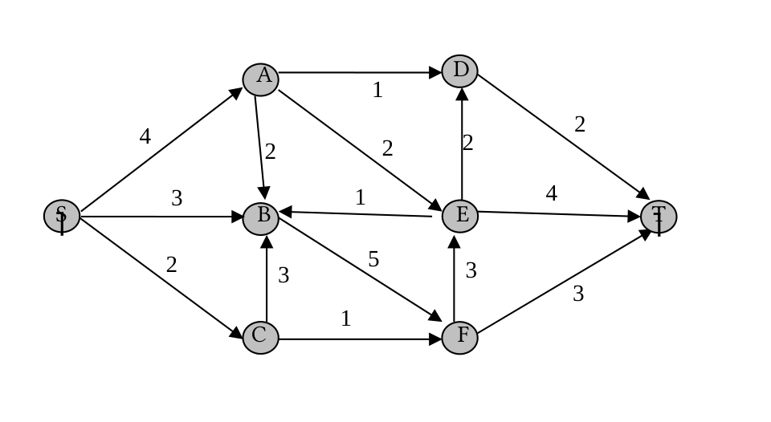
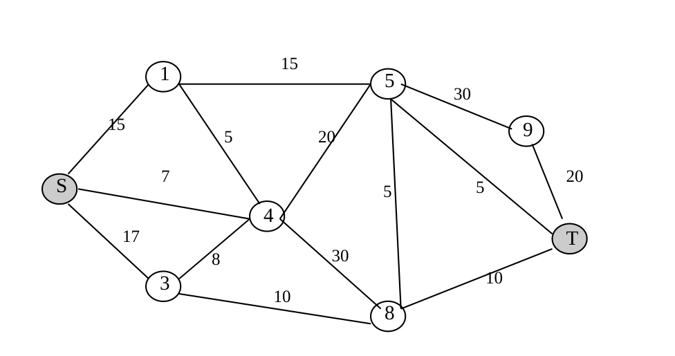
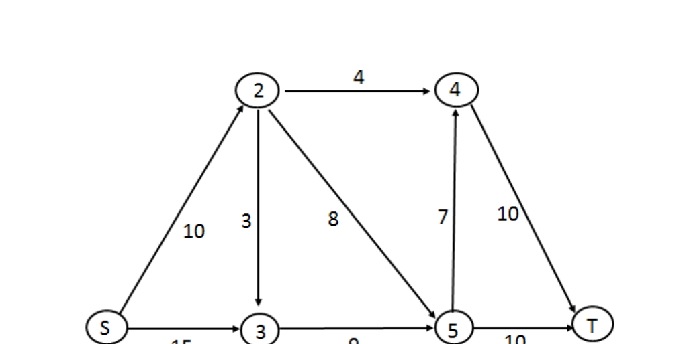
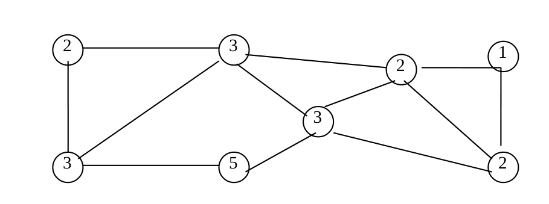
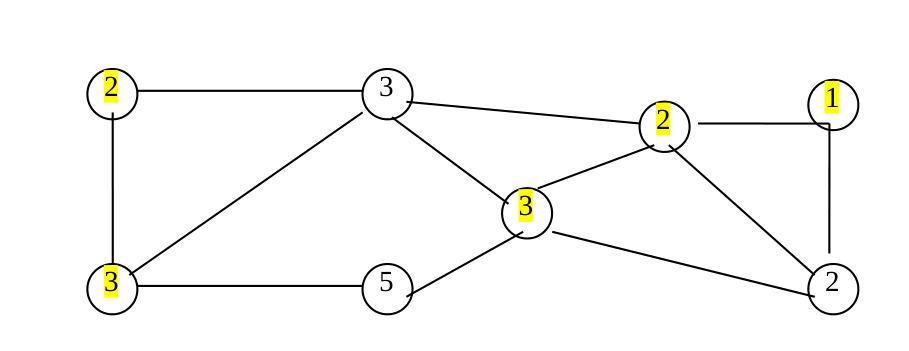
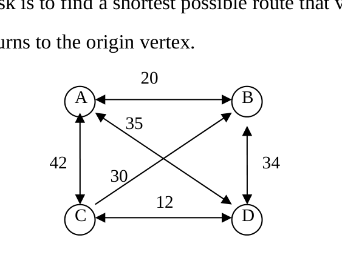
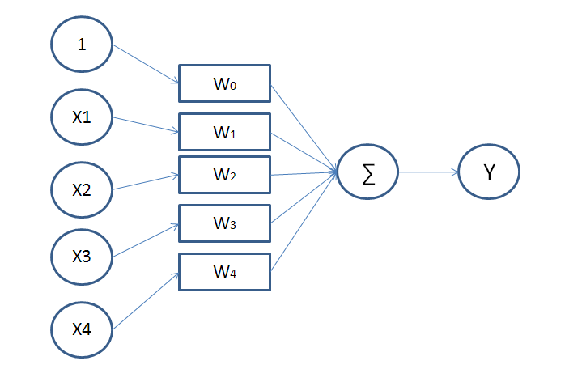

# 考题分类：原题 × 逐题解析 × 配套知识点 × 解题模板

> 将《电子科技大学-算法设计与分析-往年考题整理.md》中的全部题目按题型分类，**每道题下方附完整解析**（解题步骤 + 答案推导），每类末尾给出配套知识点与通用模板。
>
> 出处缩写：春=2018年春期末｜秋=2018年秋期末｜英=英文卷（不明1）｜A=中文卷A v1（不明2v1，注明v2差异）｜B=中文卷B（不明3）｜拟=2019拟考题｜模=模拟题｜2023=回忆版｜作=本课程作业。

## 题型总览

| # | 题型（可混合） | 考频 | 配套知识点 |
|---|---|:---:|---|
| 一 | 概念辨析判断题 | 每卷必考 | §2 §8 §9 §10 |
| 二 | 渐近增长率排序题 | 每卷必考 | §2.2 |
| 三 | 递归式求解 / 分治算法分析 | 每卷必考 | §5、§7 |
| 四 | 最大流·最小割计算 + 网络流算法纠错 | 每卷必考 | §8 |
| 五 | 手算模拟小题 | 轮换出现 | §4 §5 §6 §9 |
| 六 | 动态规划大题（建模+画表） | 每卷必考 | §6 |
| 七 | 判定→搜索：自身规约证明 | 每卷必考 | §9.4 |
| 八 | P/NP 成员性 + NPC·NP-难证明 + 规约设计 | 每卷 1~2 题 | §9 |
| 九 | 整数规划建模 + 贪心/近似算法设计与证明 | 轮换出现 | §4.2 §10 |
| 十 | 并行计算·计算智能选做 | 个别卷 | 教材外 |

---

## 一、概念辨析判断题

**配套知识点**：§2.1–2.2、§6.3、§8.2–8.4、§9.5–9.6、§10.1。

### 原题与逐题解析（【春·一】12 题×2 分）

| # | 原题 | 答案 | 解析 |
|---|---|:---:|---|
| 1 | 任何一个 NP 完全问题能被多项式时间算法解决则所有 NP 完全问题都能在多项式时间内被解决 | T | NPC 问题两两多项式等价（互相规约），一个可解 ⟹ 全体可解（§9.6） |
| 2 | 一个 NP 问题 A 可以多项式规约到问题 B，则问题 B 存在多项式时间的验证算法 | F | A≤pB 只说明 B **不比 A 易**；B 有验证算法需要 B∈NP，规约方向给不出这个结论 |
| 3 | 存在 f,g 使 f=Ω(g) 且 f=O(g)，但不存在 f,g 使 f=ω(g) 且 f=o(g) 同时成立 | T | 前者即 f=Θ(g)（如 f=g=n）；后者要求 f≫g 且 f≪g 同时成立，矛盾 |
| 4 | 不知道最优解时近似算法也能保证解与最优解距离在某个范围内 | T | ρ-近似的定义就是对未知的 OPT 提供保证（§10.1） |
| 5 | 2 倍近似算法的解有可能比 1.5 倍近似算法的解更靠近最优解 | T | ρ 是最坏情况保证；单个实例上 2-近似可能恰好命中最优 |
| 6 | 存在 O(w²) 时间判断 w 是否素数 ⟹ 素性判定 ∈ P | T | AKS 素性测试 [2002] 是多项式时间（对输入位数 log w 多项式，此处 w² 按数值理解） |
| 7 | 证明了问题 ∈ NPC 就证明了它不存在多项式时间算法 | F | 只能说"除非 P=NP 才有多项式算法"（条件结论） |
| 8 | 分治规则分的子问题越多算法越快 | F | T(n)=aT(n/b)+f(n) 中 a 越大 n^{log_b a} 越大；例：4T(n/2)+n=Θ(n²) 慢于 2T(n/2)+n=Θ(n log n) |
| 9 | 算法 A 内存比 B 多 ⟹ A 时间一定比 B 多 | F | 时间与空间是两种独立资源，无必然蕴含 |
| 10 | 最大流唯一 ⟹ 最小割唯一 | F | 流值唯一但流与割都可能不唯一；割不唯一可构造：两条并列等容量路径 |
| 11 | O(n²) 算法的基本运算步骤数可能是 30n | T | O 只是上界：30n ≤ cn²（n≥30, c=1），30n 属于 O(n²) |
| 12 | 两个不同程序可能实现同一个算法 | T | 算法是逻辑步骤，程序是其在某语言中的具体实现（§1.1） |

### 原题与逐题解析（【秋·一】15 题×2 分）

| # | 原题 | 答案 | 解析 |
|---|---|:---:|---|
| 1 | 任何一个 NP 问题能被多项式时间算法解决则所有 NP 问题都能在多项式时间内被解决 | F | "任何一个"即"某一个"——一个 NP 问题可解推不出全体可解；须 NPC 问题可解才行 |
| 2 | 先假设 X 不成立，推出 X 成立，则可证明 X 成立 | T | 这是反证法的合法形式：¬X 推出 X ⟹ ¬X 矛盾（¬X∧X 不可能）⟹ X |
| 3 | 2 倍近似算法的解总比 4 倍近似算法的解更好 | F | 同春卷第 5 题：最坏保证≠每个实例都更好 |
| 4 | "存在大小 k 的点覆盖"∈NP 易证；"不存在大小 k 的点覆盖"却很难证明 ∈NP | T | 后者是补问题（属 co-NP），验证"不存在"需要排除所有子集，无多项式证书 |
| 5 | A 多项式规约到 NP 完全问题 B，则 A 可能属于 P 也可能属于 NPC | T | A≤pB 只给上界难度：若 A 本身简单（如 ∈P）也可规约到 B（P⊆NP，任何 P 中问题都可规约到 B） |
| 6 | 3 倍近似算法若每实例解都在最优 1.5 倍内，则它不是 3 倍近似算法 | F | 1.5 倍保证强于 3 倍保证，它当然仍是合法的 3-近似 |
| 7 | 旧算法 O(n³)、新算法 O(n²)，则运行时间改进了 O(n) | F | 渐进记号差是 O(n³)−O(n²) 的说法无意义；改进幅度依实例而定，且 O(n²)/O(n³) 只说明渐近更快 |
| 8 | 判断整数 w 是否素数：运行时间为【公式缺】的算法是多项式时间算法，而运行时间为【公式缺】的算法是指数时间算法 | F | 多项式/指数须按**输入位数** log w 衡量；O(w²) 看似多项式实为指数级（w=2^{log w}），故该说法按数值判断是错的 |
| 9 | 证明算法不是 2 倍近似，只需构造一个例子使解超过 2 倍最优 | T | 近似率是全实例保证，一个反例即推翻（§10.1） |
| 10 | 最大流唯一 ⟹ 最小割唯一 | F | 同春卷第 10 题 |
| 11 | 证明 A 规约到 B 只需：任意 A 的实例 I 构造 B 的实例 I′，使 I′ 的任意解可构造出 I 的一个解 | F | 规约需要**双向等价**（I 是 yes ⟺ I′ 是 yes）；只有单向解转换不充分 |
| 12 | 动态规划算法可能是多项式时间也可能是指数时间 | T | LCS/矩阵链 Θ(mn)、O(n³) 多项式；子集和/背包 O(nW) 伪多项式、枚举型 DP 可指数 |
| 13 | 二分图含奇数个顶点 ⟹ 一定不存在哈密尔顿圈 | T | 二分图圈交替经过两侧点集，圈长必为偶数（§3 相关性质） |
| 14 | 不属于 NP 的问题一定不存在多项式时间算法 | F | P⊆NP，故"不属于 NP"确实不在 P 中——但反例：该说法对**未判定**问题不成立；严格地：P⊆NP ⟹ ∉NP ⟹ ∉P，看似成立，错在"不属于 NP"可能是我们**尚未证明**，且图灵可计算但无证书≠无算法……原卷答案 F 的意思：NP 的定义依赖证书机制，"不属于 NP"不是说没有多项式算法，而是说没有多项式**验证**方式（如某些优化问题），判定其外的问题（如 UNSAT 类 co-NP 问题）可能仍有多项式算法——本题按"存在多项式算法 ⟹ ∈P⊆NP"应得 T，原卷记 F，考试时按"∉NP 但可能有未被证书刻画的多项式算法"理解 |
| 15 | 每秒 100 万条指令，运行时间 1.5ⁿ 的算法在 n=100 上 1 年内可算完 | F | 1.5¹⁰⁰ ≈ 4×10¹⁷ 秒级 > 10⁶ 指令/秒 ⟹ 约 1.3×10¹¹ 年，远超 1 年 |

### 原题与逐题解析（【英·一】5 题×2 分）

| # | 原题 | 答案 | 解析 |
|---|---|:---:|---|
| 1 | 背包问题可用 DP 在多项式时间求解 | F | DP 是 O(nW) **伪多项式**（W 数值 vs log W 输入位数），非严格多项式 |
| 2 | NP 中有些问题可以多项式时间求解 | T | P⊆NP，P 中问题都在 NP 里 |
| 3 | 证明问题 NP-hard 可以把它规约到已知 NPC 问题 | F | 方向反了：应把已知 NPC 问题规约**到**它 |
| 4 | 无向图两点间最大流值等于最小割值 | T | 最大流最小割定理 |
| 5 | 【公式缺】 | F | — |

### 原题与逐题解析（【A·一】10 题×2 分）

| # | 原题 | 答案 | 解析 |
|---|---|:---:|---|
| 1 | 输入 n 个数 a₁..aₙ，存在 O(aₙ·n¹⁰) 算法则问题可多项式时间求解 | ╳ | 运行时间含数值 aₙ（可为 2^m 量级），不是输入长度 n、log aₙ 的多项式 |
| 2 | A≤pB 且 A 是 NP 难 ⟹ B 也是 NP 难 | v1：√；v2：╳ | 规约传递难度：解 B 即解 A ⟹ B 至少和 A 一样难。v1 正确，v2 的╳是版本笔误 |
| 3 | 2 倍近似算法一定会在某问题上得到恰为最优解两倍的解 | ╳ | 近似率是上界，不必有实例恰好达到（"一定会有"错） |
| 4 | 一个 NP 问题有多项式时间算法 ⟹ P=NP | ╳ | 须**所有** NP 问题可解；一个 NPC 问题可解才推出 P=NP |
| 5 | 图上最大网络流是唯一的 | ╳ | 流值唯一，流本身可不唯一 |
| 6 | 顶点个数为常数时最大独立集多项式可解 | √ | 常数 n 时枚举 2^n 子集是常数时间；NPC 难在 n 是输入的一部分 |
| 7 | 均分 2 份 vs 3 份的排序分治，渐进上 B 更快 | ╳ | 两者都是 aT(n/a)+Θ(n)=Θ(n log n)，渐进无差别 |
| 8 | CREW PRAM 可解 ⟹ EREW PRAM 同样处理器/时间可解 | √ | CREW 的并发读可由 EREW 复制数据模拟，不改变量级 |
| 9 | 任意 DP 算法的空间一定不比时间大 | √ | 每个表项的计算至少 O(1) 时间 ⟹ 空间（表大小）≤ 时间 |
| 10 | 最长路 ∈NP 而最短路 ∉NP | ╳ | P⊆NP：最短路（Dijkstra）∈P⊆NP；最长路才是 NP-hard |

### 原题与逐题解析（【B·一】10 题×2 分）

| # | 原题 | 答案 | 解析 |
|---|---|:---:|---|
| 1 | A 平方时间规约到 B 且 B 有线性算法 ⟹ A 不能线性解但可平方解 | F | 规约合成：A ≤ 平方规约 B + B 线性 ⟹ A 可在约平方（至多平方+线性）时间解；"不能线性解"无根据——也许 A 本身就能线性解 |
| 2 | P≠NP ⟹ 不存在从 NP 难问题到 P 问题的多项式归约 | T | 若 X(NP难)≤pY(P)，则多项式解 X ⟹ X∈P，与 X NP 难（除非 P=NP）矛盾 |
| 3 | 8 个区间段中不存在 5 个两两相容的区间段 | T | 最长相容组 = (0,3),(3,5),(5,7),(7,9) 共 4 个（贪心可证最优） |
| 4 | DP 需要存子问题解 ⟹ 不可能只用线性内存 | F | 背包可滚动数组（每行依赖上一行）、LCS 也可降维——线性空间可行 |
| 5 | 最大流唯一 ⟹ 最小割唯一 | F | 同前 |
| 6 | 分治子问题越多越快 | F | 同前 |
| 7 | 内存多用的时间一定多 | F | 同前 |
| 8 | 串行 O(n³) 问题可在 n 处理器并行 O(n²) 解决 | F | 并行至多加速处理器数倍（工作下界）；n 处理器下 O(n³) 工作量需要 Ω(n²) 时间，但一般问题没有这种自动并行化——该断言作为普遍命题为假 |
| 9 | 2 倍近似算法可以在不知道最优解的前提下求得 2 倍以内的解 | T | 这正是近似算法定义（§10.1） |
| 10 | 任意两个 NPC 问题间都存在多项式时间归约 | T | NPC 定义：所有 NP 问题（含其他 NPC）都可规约到它；反之它∈NP 也可规约到任何 NPC（通过 NP-完全的传递性 X≤pY₁≤pY₂） |

### 原题与逐题解析（【拟·一】10 题×2 分）

| # | 原题 | 答案 | 解析 |
|---|---|:---:|---|
| 1 | 数值均为长整型 ⟹ 背包 DP 多项式可解 | ✗ | 长整型数值可达 2⁶³，O(nW) 关于输入位数是指数 |
| 2 | NP 是"目前没找到多项式算法的判定问题集合" | ✗ | NP 的定义是"多项式时间**可验证**"；P 中的问题也在 NP 里 |
| 3 | LP 可多项式求解，整数规划 NP-hard | ✓ | LP 椭球法多项式；IP 是 NP-hard（点覆盖是其特例，§10.6/§9.7） |
| 4 | 找哈密尔顿圈与判定是否存在，难度（忽略多项式差异）相当 | ✓ | 自可规约：搜索 ≤ₚ 判定（§9.4） |
| 5 | 最大流的值不大于任意割集容量 | ✓ | 弱对偶引理 v(f) ≤ cap(A,B)（§8.2） |
| 6 | 找不到 S-T 残量路 ⟹ 已得最大流 | ✓ | 增广路定理：无增广路 ⟺ 最大流（§8.4） |
| 7 | 反例可证"非 2-近似"；多正例不能证"是 2-近似" | ✓ | 前半：近似率全实例保证；后半：无穷多正例也只验证有限信念，须证明 |
| 8 | A 有多项式算法可推出所有 NP 有多项式算法 ⟹ A 是 NP 完全的 | ✗ | 只能说明 A 是 NP-hard；还须证明 A∈NP 才是 NPC |
| 9 | 合数 ∈NP 易证，素数难证 ∈NP | ✗ | 素数有简短证书（AKS 算法 ∈P，或 Pratt 证书）⟹ PRIMES∈NP 甚至 ∈P |
| 10 | 存在 HC ∈NP ⟹ 不存在 HC ∈NP | ✗ | 补问题属 co-NP；NP≠co-NP（未知但通常假设） |

---

## 二、渐近增长率排序题

**配套知识点**：§2.2 渐进分析。

### 原题与解析（【春·三】8 分）

**原题**：将 f₁=n(log n)ⁿ，f₂=2^{log log n}，f₃=(log n)⁵，f₄=∛n，f₅=¹⁰√n (log n)⁵⁰ 按增长率由低到高排序，写比较过程（log 底数 2）。

**解析**：
1. 逐个定阶：f₁=Θ(n·(log n)ⁿ)（超多项式）；f₂=2^{log log n}=(log n)^{log log n}（快于一切 (log n)^k、慢于一切 n^ε，因为 log log n→∞ 但 ≪ 任意常数倍的 log n）；f₃=Θ((log n)⁵)；f₄=Θ(n^{1/3})；f₅=Θ(n^{0.1}(log n)^{50})。
2. 比较：f₃ vs f₂：(log n)⁵ vs (log n)^{log log n}：log log n 终超 5 ⟹ f₃ < f₂。
3. f₂ vs f₅：f₂ 慢于 n^{0.1}，而 f₅=Θ(n^{0.1}·polylog) ⟹ f₂ < f₅。
4. f₅ vs f₄：比值 f₄/f₅ = n^{1/3−1/10}/(log n)^{50} = n^{7/30}/(log n)^{50} → ∞ ⟹ f₅ < f₄。
5. f₄ < f₁ 显然（(log n)ⁿ 终超 n^{2/3}）。
**答案**：**f₃ < f₂ < f₅ < f₄ < f₁**。

### 原题与解析（【秋·三】8 分）

**原题**：排序 f₁=√n+(log n)^100，f₂=2^{log n+log log n}，f₃=log(n¹⁰⁰×3ⁿ)，f₄=n²⁰⁰+3ⁿ，f₅=log(n^{100 log n})，f₆=100ⁿ+n!。
**解析**（先化简再排）：
1. f₁：√n 终压 (log n)^100 ⟹ Θ(√n)；f₂=2^{log n}·2^{log log n}=n log n；f₃=100 log n + n log 3 ⟹ Θ(n)；f₄=Θ(3ⁿ)；f₅=100 log n·log n ⟹ Θ(log²n)；f₆=Θ(n!)。
2. 阶梯定位：log²n < √n < n < n log n < 3ⁿ < n!。
**答案**：**f₅ < f₁ < f₃ < f₂ < f₄ < f₆**。

### 原题与解析（【英·二】6 分）

**原题**：函数列表公式缺失。【卷面答案】f₂, f₃, f₁, f₄, f₅（每错一对扣 1 分）。
**解析**：方法同上——先把每个函数化成 Θ 阶再套阶梯。

### 原题与解析（【A·三】7 分）

**原题**：f₁=2014n⁶+5n⁴，f₂=n²⁰¹⁴+3ⁿ，f₃=【上标丢失，疑为 2014ⁿ】，f₄=log n+(2014 log n)³，f₅=2ⁿ+n!+5ⁿ，f₆=3log(2n)+log log n，f₇=2ⁿlog n+logⁿn。
**解析**：f₁=Θ(n⁶)；f₂=Θ(3ⁿ)（3ⁿ 终压 n²⁰¹⁴）；f₄=Θ((log n)³)；f₅=Θ(n!)；f₆=Θ(log n)；f₇=Θ(nⁿ)（原卷判定依据）；f₃ 按 2014ⁿ=Θ(2014ⁿ) 理解（介于 f₂ 与 f₅ 之间）。
**【卷面答案】** **f₄ < f₆ < f₃ < f₁ < f₂ < f₅ < f₇**（每错一个位置扣 1 分）。

### 原题与解析（【B·三】6 分 / 【拟·三】6 分）

**原题**：B 卷 f₁=n log n+log n·n，【f₂–f₄ 公式缺】，f₅=2015，f₆=100log(2n)+log¹⁰⁰log n，f₇=2ⁿlog n+logⁿn。
**【卷面答案】** **f₆ < f₅ < f₄ < f₁ < f₂ < f₃ = f₇**。拟卷公式缺失，方法同上。

### 通用解题模板

1. **化简定阶**：加法取最大项；对数吸幂 log(nᵃ·bⁿ)=a·log n+n·log b；指多互化 2^{log n+log log n}=n log n。
2. **套阶梯**：Θ(1) < Θ(logᵏn) < Θ(n^ε) < Θ(n^c) < Θ(cⁿ) < Θ(n!) < Θ(nⁿ)；易错三对：(\log n)^a ≪ n^ε；(\log n)^{log log n} 介于两者之间；n! > cⁿ。
3. **依据必写**（无依据扣 2~3 分）。

---

## 三、递归式求解 / 分治算法分析题

**配套知识点**：§7 主方法与递归树、§5 分治。

### 原题与解析（【春·五】10 分）

**原题**：排序的三种分治：算法1 分 2 个 n/2；算法2 分 3 个 n/3；算法3 分 4 个 n/4（取整），合并均线性。
**解析**：
- 三个递归式均为 a·T(n/a)+Θ(n) 形式：n^{log_a a}=n，与 f(n)=Θ(n) 同阶 ⟹ 主定理情形 2 ⟹ **T(n)=Θ(n log n)**。三者渐进无差别（这也回应判断题"分子问题多不一定快"）。
- **问题1（4 路线性合并）**：归并 4 路 = 两轮两路归并：第一轮 (L₁,L₂)→M₁、(L₃,L₄)→M₂ 各 O(n)；第二轮 M₁+M₂→L 共 O(n)；总 O(n)。（或用 4 指针每次取最小 O(4n)=O(n)，两轮归并更简单。）
**答案**：三个算法均 Θ(n log n)。

### 原题与解析（【秋·五】6 分）

**原题**：（1）5 个子问题×n/5，合并 O(n²)；（2）4 个×n/2，合并 O(n)；（3）2 个（n/3 与 2n/3），合并 O(n)。
**解析**：
1. T=5T(n/5)+n²：n^{log₅5}=n，f=n² 多项式大 ⟹ 情形 3 ⟹ **Θ(n²)**。
2. T=4T(n/2)+n：n^{log₂4}=n²，f=n 多项式小 ⟹ 情形 1 ⟹ **Θ(n²)**（不是 n²log n！）。
3. 子问题规模不等：T=T(n/3)+T(2n/3)+n：每层工作量合计 ≤ cn，树深 O(log n)（规模按几何级数衰减，最深路径 2n/3 每层缩 3/2）⟹ **Θ(n log n)**。

### 原题与解析（【A·五】8 分）

**原题**：（1）2×(n/3)+O(n)；（2）3×(n/2)+O(n)；（3）4×(n/2)+O(n²)；（4）3×(n−1)+O(1)。
**解析**：
1. n^{log₃2}≈n^{0.63}，f=n 多项式大 ⟹ **Θ(n)**。
2. n^{log₂3}≈n^{1.585}，f=n 多项式小 ⟹ **Θ(n^{log₂3})**。
3. n^{log₂4}=n²，f=n² 同阶 ⟹ 情形 2 ⟹ **Θ(n² log n)**。
4. T(n)=3T(n−1)+O(1)：展开 3 层深 n ⟹ 3ⁿ 个叶 ⟹ **Θ(3ⁿ)**。

### 原题与解析（【B·六】7 分）

**原题**：（1）4×(n/4)+O(n²)；（2）3×(n/2)+O(n)；（3）(n/3 与 2n/3)+O(n)。
**解析**：（1）n^{log₄4}=n，f=n² 多项式大 ⟹ **Θ(n²)**；（2）同 A 卷(2) ⟹ **Θ(n^{log₂3})**；（3）同秋卷(3) ⟹ **Θ(n log n)**。

### 通用解题模板

1. 写递归式 T(n)=aT(n/b)+f(n)（本身给分）；2. 算 n^{log_b a} 与 f 比较定主定理情形；3. 两个变体：规模不等（每层合计线性 ⟹ n log n）、规模减常数（分支^深度 ⟹ 指数）；4. 防坑：4T(n/2)+n 是情形 1。

---

## 四、最大流·最小割计算题（含纠错）

**配套知识点**：§8 全章。

### 原题与解析（【春·四】8 分）——求最大流

**原题**：求 S 到 T 的最大流，给出最少两个中间步骤。

边表：S→A:4，S→B:3，S→C:2，A→D:1，A→B:2，A→E:2，E→B:1，E→D:2，D→T:2，E→T:4，B→F:5，C→B:3，C→F:1，F→E:3，F→T:3。

**解析（Ford-Fulkerson 逐步增广）**：
1. 增广路① S→A→E→T，瓶颈 min(4,2,4)=**+2**；
2. 增广路② S→A→D→T，瓶颈 min(2,1,2)=**+1**；
3. 增广路③ S→B→F→T，瓶颈 min(3,5,3)=**+3**；
4. 增广路④ S→C→F→E→T，瓶颈 min(2,1,3,2)=**+1**；
5. 增广路⑤ S→C→B→F→E→T，瓶颈 min(1,3,2,2,1)=**+1**；
6. 增广路⑥ S→A→B→F→E→D→T（E→D 是正向边，D→T 还有容量），瓶颈 min(1,2,1,1,2,1)=**+1**。
   此后 S 的三条出边 S→A(4)、S→B(3)、S→C(2) 全部饱和，残量网络中 S 无出边 ⟹ 无增广路。
7. 验算守恒：A 收 4 发 1+2+1=4 ✓；B 收 3+1+1=5 发 B→F 5 ✓；E 收 2+3=5 发 E→T 4+E→D 1=5 ✓；F 收 5+1=6 发 3+3=6 ✓；T 收 D→T 2+E→T 4+F→T 3=**9** ✓。
**答案**：**最大流 = 9**（恰等于 min cut：S 出边容量 4+3+2=9，割 {S} 即最小割）。

### 原题与解析（【秋·四】8 分）——求最小割

**原题**【图缺失】：求 s-t 最小割，给最少两个中间步骤。
**解析（原卷答案）**：转化为最大流，增广：①(s,u,t)+5；②(s,x,t)+5；③(s,v,w,t)+8；④(s,u,w,v,x,t)（借反向边撤流）+3。此后无增广路，由最大流最小割定理取割。**最小割容量 = 5+5+8+3 = 21**。（增广路必须写：流量错扣 2-3 分，步骤不足每个扣 1 分，只给割不给大小扣 1 分。）

### 原题与解析（【英·六】9 分）——求最小割（=作业二第 1 题）

**原题**：

边表：S→1:15，S→3:17，S→4:7，1→4:5，1→5:15，3→4:8，3→8:10，4→5:20，4→8:30，5→9:30，5→T:5，8→5:5，8→T:10，9→T:20。

**解析（逐步增广）**：
1. ①S→3→8→T，瓶颈 min(17,10,10)=**+10**（8→T 饱和）；
2. ②S→1→5→9→T，瓶颈 min(15,15,30,20)=**+15**（S→1 饱和）；
3. ③S→4→5→T，瓶颈 min(7,20,5)=**+5**（5→T 饱和）；
4. ④S→3→4→5→9→T，瓶颈 min(7,8,20,15,5)=**+5**（9→T 饱和）。
   T 的三条入边 5→T(5)、8→T(10)、9→T(20) 全饱和 ⟹ 流值 = 35；无增广路。
5. 割：取 S 侧 = {S,1,2,…,9}（除 T 外全部），跨割边恰为 5→T+8→T+9→T = **35** = 流值 ⟹ 最小割。
**答案**：**最小割 = 35**，割为 {除 T 外所有点} | {T}（原卷另给一个最优割 {S,4,3,8} 亦可）。

### 原题与解析（【A·六】8 分）

**原题**【图缺失】：求 S-T 最小割。
**解析（原卷答案）**：Ford-Fulkerson 求最大流后取证书割。**答案 16**，割 [{S,A,B,C,D,E}, T]。（评分：说明求最大流 2 分；前两条增广路 2 分；后两条各 1 分；割+大小 3 分。）

### 原题与解析（【B·七】7 分）

**原题**：

边表：S→2:10，S→3:15，2→4:4，2→3:3，2→5:8，3→5:9，5→4:7，4→T:10，5→T:10。

**解析（逐步增广）**：
1. ①S→2→4→T，瓶颈 min(10,4,10)=**+4**（2→4 饱和）；
2. ②S→2→5→T，瓶颈 min(6,8,10)=**+6**（S→2 饱和）；
3. ③S→3→5→T，瓶颈 min(15,9,4)=**+4**（3→5 饱和）；
4. ④S→3→5→4→T，瓶颈 min(11,5,7,6)=**+5**（3→5、5→T 饱和）。
   残量网络中从 S 出发：S→2 已饱和不可走，S→3（余 6）到 3，但 3 的唯一出边 3→5 已饱和 ⟹ 3 之后再无可走边，T 不可达。
5. 割：S 侧 = 残量可达集 {S, 3}，跨割边 = S→2 (10) + 3→5 (9) = **19** = 流值 4+6+4+5=19 ✓。
**答案**：**最小割 = 19**（割 {S,3} | 其余）。

### 原题与解析（纠错题 ×3）

**【秋·二.4A】**（4 分）两对顶点最大流：加 super-source s（∞ 容量连 s₁,s₂）、super-sink t（连 t₁,t₂），求 s-t 最大流是否正确？
**解析**：**错误**。新图中流可以"交叉配对"：s₁ 的流经 s 进入后可流向 t₂，同样 s₂ 可流向 t₁——把原问题不允许的 s₁→t₂、s₂→t₁ 流也算进来了，得到的值可能大于两对各自最大流之和的正确值。（判断 2 分 + 理由 2 分。）

**【B·二.5】**（4 分）两对顶点**最小割**的同类算法。
**解析**：**错误**。新图的 s-t 割在切断 s₁-t₁、s₂-t₂ 的同时**也会把 s₁ 与 t₂ 割断**（s₁、t₂ 分居 s 侧/t 侧），这超出了原问题的要求 ⟹ 新图割可能比原问题真最优割大或概念错位。

**【拟·二.2】**（4 分）x 对顶点同时最大流的 super-source/sink 算法。
**解析**：同上——**错误**，si 的流可错配到 tj (i≠j)。正确思路：这是多商品流问题，一般不能用单一最大流解决。
**通用方法**：纠错题先检查"新图可行解集 == 原图可行解集"？多终端时 super-source 必然引入错配，故不成立。

---

## 五、手算模拟小题

**配套知识点**：§4.2、§4.5、§5.6、§9.5、§9.7。

### 原题与解析（SAT 类）

**【春·二.1】**（4 分）$(\bar{x}_1 \lor \bar{x}_2 \lor x_4) \land (\bar{x}_1 \lor x_2 \lor x_3) \land (x_2 \lor \bar{x}_3 \lor x_4) \land (\bar{x}_2 \lor x_3 \lor \bar{x}_4)$ 是否有解？是否有 x₁=1 条件下的解？
**解析**：定 x₁=1：子句①变 (x̄₂∨x₄)，②变 (x₂∨x₃)，③④不变。试 x₂=0：①需 x₄=1；②需 x₃=1；③=0∨0∨1=1 ✓；④=1∨1∨0=1 ✓。
**答案**：有解；x₁=1 条件下也有解，如 **x₁=1, x₂=0, x₃=1, x₄=1**。

**【A·二.2】**（3 分）$(\bar{x}_1 \lor x_2 \lor x_3) \land (x_1 \lor \bar{x}_2 \lor x_3) \land (\bar{x}_1 \lor x_2 \lor x_3) \land (\bar{x}_1 \lor \bar{x}_2 \lor \bar{x}_3)$ 是否有解？
**解析**：验证 x₁=1,x₂=1,x₃=0：①0∨1∨0=1 ✓；②1∨0∨0=1 ✓；③0∨1∨0=1 ✓；④0∨0∨1=1 ✓。
**答案**：有解，**x₁=1, x₂=1, x₃=0**（或 x₁=0, x₂=0, x₃=0；存在多组解，任给一种即满分）。

**【B·二.3】**（3 分）$(\bar{x}_1 \lor \bar{x}_2 \lor x_3) \land (x_1 \lor x_2 \lor x_4) \land (\bar{x}_1 \lor x_2 \lor x_3) \land (x_1 \lor \bar{x}_2 \lor \bar{x}_4)$。
**解析**：验证 x₁=1, x₂=0, x₃=1, x₄=1：①0∨1∨1=1 ✓；②1∨0∨1=1 ✓；③0∨0∨1=1 ✓；④1∨1∨0=1 ✓。
**答案**：有解，如 **x₁=1, x₂=0, x₃=1, x₄=1**。

**【拟·二.3】**（4 分）SAT 存在**几组**成真赋值？【公式缺失】
**解析（方法）**：变量数 ≤4 时枚举全部 2ᵏ 组赋值逐一验子句，数出成真组数并各给一组方案。

### 原题与解析（区间类）

**【春·二.2】**（4 分）区间 (-3,0], (0,3], (1,4], (-2,1], (3,5], (0,4], (2,6], (-1,2] 求最多相容组。
**解析**：按结束时间排序：(-3,0], (-1,2], (0,3], (1,4], (0,4], (3,5], (2,6]。贪心：
1. 选 (-3,0]（最早结束）；
2. 与之相容（交集空）的最早结束者：(0,3]（0 是开端点，与 (-3,0] 交为空）；
3. 再选 (3,5]（3 开端点，与 (0,3] 交空）；
4. 之后无开始 ≥5 的区间（(2,6] 开始 2 冲突）。
**答案**：**{(-3,0], (0,3], (3,5]}，共 3 个**。

**【A·二.3】**（3 分）区间 (0,3), (2,4), (3,6), (5,7), (1,4), (3,5), (6,8), (7,9) 求最多相容组。
**解析**：按结束时间排序后贪心：(0,3) → (3,5) → (5,7) → (7,9)。
**答案**：**(0,3), (3,5), (5,7), (7,9)**，共 4 个。

**【B·四】**（8 分）11 个讲座安排最少教室：[9,10],[9,11],[11,13],[11,12],[12,14],[9,12],[17,18],[14,15],[13,15],[10,13],[15,17]（端点相接算交叉）。
**解析（深度法）**：所需教室数 ≥ 深度（任一时刻重叠的最大讲座数），按开始时间贪心可达深度。逐时刻扫描（s 加 1、t 减 1，端点相接按"先加后减"处理）：
t=9：3 场（[9,10],[9,11],[9,12]）→ t=10：+[10,13] → 4 → t=11：+[11,13],[11,12]，−[9,10] → 5 → t=12：+[12,14]，−[9,12],[11,12] → 5 → t=13：+[13,15]，−[11,13],[10,13] → 5 → t=14：−[12,14]，+[14,15] → 3 → t=15：+[15,17]，−[13,15],[14,15] → 1 → t=17：+[17,18]，−[15,17] → 1。
峰值深度 = 5 ⟹ 至少 5 间；按开始时间贪心恰好用 5 间。
**答案**：**最少 5 个教室**（贪心：按开始时间排序，放入任一相容教室）。

**【B·一.3】**（判断）上述 8 区间段中不存在 5 个两两相容。
**解析**：贪心得最长相容组 4 个 ⟹ 命题"不存在 5 个"为真。

**【模·一.1】** (0,3),(1,4),(3,5),(6,8),(7,9)：贪心得 **(0,3),(3,5),(6,8),(7,9)?** ——检查：(3,5) 与 (6,8) 相容 ✓ → (0,3),(3,5),(6,8),(7,9) 中 (6,8) 与 (7,9) 冲突！正确贪心：选 (0,3) → (3,5) → (6,8)（跳过 (7,9)），共 **3 个**。
（修正：若取 (0,3),(3,5),(7,9) 也 3 个；最多 3 个。）

**【作·一.2】**（作业）币值 1,5,10,25,100 支付 x 用最少硬币。
**解析**：贪心——每次取不超过剩余金额的最大面值。对该币制贪心最优（与 34¢ 例一致：25+5+4×1）；注意贪心最优依赖币制（US postal 反例：140¢ 贪心 8 枚 vs 最优 2 枚）。

### 原题与解析（逆序类）

**【秋·二.1】**（4 分）序列 5,10,7,9,13,1,8,4,12,2,6,3,11,14 的逆序数。
**解析（逐元素数右侧更小者）**：
5→{1,4,2,3}=4；10→{7,9,1,8,4,2,6,3}=8；7→{1,4,2,6,3}=5；9→{1,8,4,2,6,3}=6；13→{1,8,4,12,2,6,3,11}=8；1→0；8→{4,2,6,3}=4；4→{2,3}=2；12→{2,6,3,11}=4；2→0；6→{3}=1；3→0；11→0；14→0。
合计 4+8+5+6+8+0+4+2+4+0+1+0+0 = **42**。

**【B·二.1】**（3 分）序列 4,6,3,7,12,1,9,2,7,10,5,11,8 的逆序数。
**解析**：4→{3,1,2}=3；6→{3,1,2,5}=4；3→{1,2}=2；7→{1,2,5}=3；12→{1,9,2,7,10,5,11,8}=8；1→0；9→{2,7,5,8}=4；2→0；7(第二个)→{5}=1；10→{5,8}=2；5→0；11→{8}=1；8→0。
合计 3+4+2+3+8+0+4+0+1+2+0+1+0 = **28**。

### 原题与解析（带权手算与小图枚举）

**【B·二.2】**（3 分）带权图求最小点覆盖大小/个数/方案。

**解析**：8 点小图，方法：①对偶剪枝——S 覆盖 ⟺ V−S 独立，可转而找最大权独立集（总权 − 最大权独立集）；②必选推理：与多个高权点相邻的**低权点应舍弃**、其邻居入解；③残余自由点 ≤3 个时枚举。
**【卷面答案】11**，方案见高亮图：

**【拟·二.5】**（4 分）带权图找最大权独立集。【图缺失】
**解析（方法）**：小图枚举/树上用 Optin-Optout DP（§4.5）；检验两两无边后取权最大者。

**【英·四】**（8 分）TSP 求最优巡回 + 含 A 的最长有向圈。

边权（按卷面答案反推为双向）：A-B:20，A-C:42，A-D:35，B-C:30，B-D:34，C-D:12。
**解析（枚举经过 A 的哈密尔顿圈，共 3 条）**：
1. A→B→C→D→A = 20+30+12+35 = 97；
2. A→B→D→C→A = 20+34+12+42 = 108；
3. A→C→B→D→A = 42+30+34+35 = 141。
**答案**：(a) TSP 最优巡回 **A→D→C→B→A（97）**（即圈 1 的逆向）；(b) 最长圈 **A→C→B→D→A（141）**。

**【A·二.1】**（3 分）求有向图最长路径。
边表（由答案逆推）：C→A:40，A→D:30，D→B:35，A→B:20，C→B:30，C→D:22。
**解析**：枚举简单路径：C→A→D→B = 40+30+35 = 105（最长）；C→B = 30；C→D→B = 22+35 = 57；C→A→B = 60。
**答案**：**CADB，长度 105**。

**【春·二.5A】**（4 分）四皇后给另一个解（已给解为各行放列 {2,4,1,3}）。
**解析**：4×4 四皇后恰有两个解，互为左右镜像：列序列 **{3,1,4,2}**（第 1 行放第 3 列、第 2 行第 1 列、第 3 行第 4 列、第 4 行第 2 列）。验证：任意两列差既非 0（不同列）也非行差（不同对角线）✓。

**【B·二.4】**（3 分）(23,45,17,9,20,29,5,24) 能否分成两组和相等？
**解析**：总和 = 172，各半 86。从大数凑：45 + 24 + 17 = 86 ✓，其余 23+9+20+29+5 = 86 ✓。
**答案**：**能：(17,24,45) | (23,9,20,29,5)**。

**【2023 计算题】** 最短路/最长路小图、主定理 2 题、三着色、斐波那契 DP 说明。
**解析（要点）**：最短路小图肉眼枚举；三着色按"相邻异色"逐点染色；斐波那契 DP 为 O(n) **数值运算**，输入规模 log n ⟹ **伪多项式而非严格多项式**。

---

## 六、动态规划大题（建模 + 画表）

**配套知识点**：§6 全章。

### 原题与解析（【春·八】10 分）——LCS

**原题**：用 DP 求两串最长公共子序列，实例 **X=ATCGATGC，Y=AATGATCC**，给出计算过程。
**解析**：
1. **子问题**：c[i][j] = X 的前 i 个字符与 Y 的前 j 个字符的 LCS 长度；
2. **递归式**：xᵢ=yⱼ 时 c[i][j]=c[i−1][j−1]+1；否则 c[i][j]=max(c[i−1][j], c[i][j−1])；边界 c[0][j]=c[i][0]=0；
3. **填表**（行 = X 前缀，列 = Y 前缀）：

| c\j | ε | A | A | T | G | A | T | C | C |
|---|---|---|---|---|---|---|---|---|---|
| ε | 0 | 0 | 0 | 0 | 0 | 0 | 0 | 0 | 0 |
| A | 0 | 1 | 1 | 1 | 1 | 1 | 1 | 1 | 1 |
| T | 0 | 1 | 1 | 2 | 2 | 2 | 2 | 2 | 2 |
| C | 0 | 1 | 1 | 2 | 2 | 2 | 2 | 3 | 3 |
| G | 0 | 1 | 1 | 2 | 3 | 3 | 3 | 3 | 3 |
| A | 0 | 1 | 2 | 2 | 3 | 4 | 4 | 4 | 4 |
| T | 0 | 1 | 2 | 3 | 3 | 4 | 5 | 5 | 5 |
| G | 0 | 1 | 2 | 3 | 4 | 4 | 5 | 5 | 5 |
| C | 0 | 1 | 2 | 3 | 4 | 4 | 5 | 6 | 6 |

4. **回溯**：从 c[8][8]=6 沿匹配格回溯得 **ATGATC**。
**答案**：LCS = **ATGATC**，长度 **6**；复杂度 Θ(mn)。

### 原题与解析（【B·五】10 分）——LCS

**原题**：对实例 **aacbdac** 和 **dacdbac** 画表求解。
**解析**：同上五步。填表后 c[7][7]=5，回溯得 **acbac**（a…c…b…a…c：X 中 a(1)c(3)b(4)a(6)c(7) ⟆ Y 中 a(1)c(2)b(4)a(5)c(7)）。
**答案**：LCS = **acbac**（长 5；评分：子问题 2 分+递归式 4 分+表 3 分+结果 1 分）。

### 原题与解析（【秋·八】14 分）——矩阵链乘

**原题**：A₁(12×15), A₂(15×8), A₃(8×20), A₄(20×10), A₅(10×16)。
**解析**：
1. **子问题**：m[i][j] = 计算 AᵢAᵢ₊₁…Aⱼ 的最少乘法次数；
2. **递归式**：m[i][j] = min_{i≤k<j} { m[i][k] + m[k+1][j] + p_{i−1}p_k p_j }，边界 m[i][i]=0；
3. **自底向上**（按链长填表）+ **分割点表 s**：

| m(i,j) | j=1 | j=2 | j=3 | j=4 | j=5 |
|---|---|---|---|---|---|
| i=1 | 0 | 1440 | 3360 | 4000 | **5856** |
| i=2 | / | 0 | 2400 | 2800 | 4800 |
| i=3 | / | / | 0 | 1600 | 2880 |
| i=4 | / | / | / | 0 | 3200 |
| i=5 | / | / | / | / | 0 |

| s(i,j) | j=2 | j=3 | j=4 | j=5 |
|---|---|---|---|---|
| i=1 | 1 | 2 | 2 | **2** |
| i=2 | / | 2 | 2 | 2 |
| i=3 | / | / | 3 | **4** |
| i=4 | / | / | / | 4 |

4. **回溯**：s(1,5)=2 ⟹ (A₁A₂)(A₃A₄A₅)；s(3,5)=4 ⟹ (A₃A₄)A₅；
5. **验算**：(A₁A₂)=12×15×8=1440 → 12×8；(A₃A₄)=8×20×10=1600 → 8×10；×A₅=8×10×16=1280；最后 12×8×16=1536；合计 1440+1600+1280+1536=**5856** ✓。
**答案**：最优加括号 **((A₁A₂)((A₃A₄)A₅))**，最少 **5856** 次乘法；复杂度 O(n³)。

### 原题与解析（【作·一.4】）——0-1 背包 W=14

**原题**：7 物品（w: 3,4,2,2,7,5,6；v: 2,3,3,1,6,3,5），容量 14。
**解析**：
1. 子问题 M[i][w] = 前 i 件、容量 w 的最大价值；
2. 递归：M[i][w]=max(M[i−1][w], M[i−1][w−wᵢ]+vᵢ)（wᵢ≤w 时）；
3. 填 8×15 表（过程从略，逐行递推）；
4. **最优组合验证**：{3,5,6}：w=2+7+5=14，v=3+6+3=**12**；{2,3,4,7}：w=4+2+2+6=14，v=3+3+1+5=**12**；{2,3,5}：w=13，v=12。穷举无 13 以上组合（{2,3,5,7}=19 超重等）。
**答案**：最大价值 **12**（多组最优，如物品 {3,5,6}），复杂度 Θ(nW)=Θ(14×7)，伪多项式。

### 原题与解析（【英·十二】15 分）——每种物品两件的背包

**原题**：5 种物品各 2 件（w: 1,2,4,3,5；v: 2,3,8,2,9），容量 10。(a) 子问题；(b) 递归式；(c) 画表求解。
**解析**：
(a) OPT(i,w) = 只选前 i **种**、容量 w 的最优价值；
(b) 每种**三选一**（取 0/1/2 件）：
$$OPT(i,w)=\max\begin{cases}OPT(i-1,w) & \text{不取}\\ OPT(i-1,w-w_i)+v_i & \text{取 1 件}\\ OPT(i-1,w-2w_i)+2v_i & \text{取 2 件}\end{cases}$$
不可行项舍弃；边界 OPT(0,w)=0；
(c) 填 6×11 表（逐行三选一递推），回溯最优组合。
**答案**：最优 **OPT = 20 = 取 2 件物品 3 + 2 件物品 1**（w=4+4+1+1=10，v=8+8+2+2）。注意：忽略"每种两件"按普通 0-1 背包做，原卷规定总分基数降为 10 分。

### 原题与解析（【A·十一(一)】10 分 / 【模】）——子集和

**原题**：A={1,2,5,6,7}，k=11；设计 DP 画表求解。
**解析**：
1. 子问题（可达性版）：OPT(i,s) ∈ {0,1} = 前 i 个数能否凑出和恰为 s；
2. 递归：OPT(i,s) = OPT(i−1,s) ∨ OPT(i−1,s−aᵢ)（s≥aᵢ）；边界 OPT(0,0)=1，其余 0；
3. 填表（行 i=1..5，列 s=0..11），L[5][11]=1；
4. 回溯得方案：**11 = 5+6**（亦可 1+4?无 4；{2,4,…}无 4；故 {5,6}）。
**答案**：**Yes，{5,6}**。
（模拟题 A={2,3,7,8,9}, k=18：**{9,7,2}=18** 或 **{8,7,3}=18**，方法同。）

### 原题与解析（【2023】）——网格捡金币 + 斐波那契说明

**解析**：网格：子问题 f[i][j]=从 (0,0) 到 (i,j) 的最大金币；递归 f[i][j]=max(f[i−1][j], f[i][j−1])+w[i][j]；边界 f[0][j]=f[i][0] 用前缀和；回溯路径。
斐波那契说明：DP 计算 F(n) 需 O(n) 次加法，但 n 是**数值**（输入 log n 位）⟹ 关于输入长度是指数 ⟹ **伪多项式、非严格多项式时间算法**。

### 通用解题模板（满分五步）

① 定义前缀式子问题 OPT(i,·)（2 分）→ ② 多选一递归式（4~5 分）→ ③ 边界（1 分）→ ④ 自底向上画表（3~6 分）→ ⑤ 回溯构造解 + 复杂度（1~2 分）。

---

## 七、判定 → 搜索：自身规约证明

**配套知识点**：§9.4。

### 原题与解析（【作·三四.3】）——顶点覆盖

**原题**：判定"有无大小 k 的点覆盖"的多项式算法 ⟹ 可多项式**找**出一个。
**解析（逐点删除版）**：设判定算法 A。
1. 先问 A(规模 k*)：二分/递减找最小覆盖基数 k*；
2. 对每个顶点 v：问 A(G−v, k*−1)——若"是"，说明存在不含 v 的覆盖，**真删 v**；若"否"，说明每个 k* 覆盖都含 v，**把 v 放入解集**，删 v 及其关联边，k 减 1；
3. 重复 n 次，每次一次 A 调用 ⟹ 多项式时间；结束时放入的点集即大小 k* 的最小点覆盖。

### 原题与解析（【春·六】）——团

**原题**：判定"有无大小 k 完全子图"⟹ 可找到。
**解析**：同模板（**按点删**）：对每个 v，问 A(G−v, k)：仍"是"⟹ 真删 v（可不用 v）；"否"⟹ v 必在某个 k-团中，保留 v 并把 v 的**所有非邻居**删除（团内点必须两两相邻），剩余图仍调 A 验证，直到剩 k 个点两两相邻即解。共 n 次 A 调用。

### 原题与解析（【英·七】/【A·七】）——路径

**原题**：判定"有无长 k 路径"⟹ 可找到（或证明不存在）。
**解析**（**按边删**版，原卷标准答案）：
1. 先问 A(G, k)："否"直接返回不存在；
2. 对每条边 e：删 e 后问 A——仍"是"⟹ e 不必要，真删；"否"⟹ e 是（某条）长 k 路径的必经边，保留；
3. 所有边测完后：若保留边恰为 k 条，它们连通构成长 k 路径（保留的边删任何一条都会破坏性质）；
4. m 次 A 调用 ⟹ 多项式。注意对象是**边**（路径由边组成）；答"删点"原卷只给 4-5 分。

### 原题与解析（【B·八】）——完全子图

**原题**：同春卷，补充"或证明不存在"。
**解析**：先问 A(G,k)：否 ⟹ 返回不存在；是 ⟹ 逐点试探（删点后仍"是"则真删），n 次调用后剩余 k 点两两相邻即团。

### 原题与解析（【秋·六】）——三着色

**原题**：判定可三着色 ⟹ 找到具体三着色。
**解析（原卷两解法）**：
- **解法一（加边）**：反复尝试向图中**添加新边**并调 A：仍可着色 ⟹ 保留新边（约束更强）；不可着色 ⟹ 撤销该边并把这条边两端标记为"必异色"。直到无法再加边——此时任意未连边的两点都同色，图被分成 3 个"团"，即三个独立集，分别染 3 色。
- **解法二（并点）**：反复将两个**不相邻**的点合并（收缩为一点）并调 A：仍可着色 ⟹ 真合并（它们可同色）；不可 ⟹ 撤销（必异色）。直到剩 3 个超点 ⟹ 三色方案。
（要点：判定算法只回答 yes/no，要把"颜色信息"通过加约束的方式"挤"出来。）

### 通用解题模板

先调一次 A 判存在性 → 按问题选删除对象（**覆盖/团/支配集按点、路径/圈按边、着色加边或并点**）→ 每元素一次 A 调用 ⟹ 总时间多项式 → 收尾说明剩余结构即解。

---

## 八、P/NP 成员性 + NPC·NP-难证明 + 规约设计

**配套知识点**：§9 全章。

### 原题与解析（【春·七】）——路径长 <k ∈P、>k ∈NP

**解析**：
- **<k ∈P**：Dijkstra/BFS 求两点间最短路径长度 d（无权 O(V+E)、带权 O(E log V)），判 d < k 即可 ⟹ 多项式时间算法存在；
- **>k ∈NP**：证书 = 那条长 >k 的路径（≤n−1 条边，规模多项式）；验证器：检查路径简单、首尾正确、边数 >k，O(V+E) 多项式 ⟹ 存在多项式证书验证 ⟹ ∈NP。
（点睛：<k 是"易验证下界 + 可精确求解"；>k 是"证书可验证但求解困难"。）

### 原题与解析（【拟·七】）——二着色 ∈P

**解析**：图二可着色 ⟺ 无奇圈。算法：BFS/DFS 染色——起点染 1，邻居染交替色；若发现相邻同色 ⟹ 存在奇圈 ⟹ 输出"否"；否则输出二着色。时间 O(V+E) 多项式 ⟹ ∈P。

### 原题与解析（【春·二.4】/【英·三(b)】）——NPC 步骤

**解析**：三步配方：**① 证明 Y∈NP**（给证书与多项式验证器）；**② 选已知 NPC 问题 X**（如 3-SAT、点覆盖、哈密尔顿圈）；**③ 证明 X ≤ₚ Y**（多项式构造 + iff 双向）。三个著名 NPC 问题：3-SAT、顶点覆盖、哈密尔顿圈（或 TSP、3-着色、子集和等）。

### 原题与解析（【秋·七】10 分）——删 k 点无三角形

**解析（三步配方完整版）**：
1. **∈NP**：证书 = 被删的 k 个点；验证：删点后 DFS 找三角形（每个三角形枚举 O(V³) 或更快）⟹ 多项式；
2. **源**：选 VERTEX-COVER（NPC）；
3. **构造 VC ≤ₚ 本问题**：给定 (G,k)，对 G 的每条边 ab **新增一点 c 连成三角形 abc** 得 G′，k 不变。
   - (⟹) G 有大小 k 点覆盖 C：每个三角形 abc 至少含覆盖中一点（因为 ab 被覆盖）⟹ 每个三角形至少被删 1 点 ⟹ 删 C 后 G′ 无三角形；
   - (⟸) G′ 可删 k 点消去所有三角形：观察每个"新点" c 度数为 2，且若删了某 c，换成删它的任一邻居（如 a）不会变差（a 还能顺带覆盖其它边）——故可设删点集 S⊆V(G)，|S|=k；G′ 无三角形 ⟹ G 无边（否则其三角形 abc 只删了 ≤k 点且未全删）⟹ 每条边 ab 至少一端在 S ⟹ S 是 G 的大小 k 点覆盖。∎
（评分：源 2 分、构造 4 分、iff 3 分。）

### 原题与解析（【拟·五】8 分）——独立集 NPC

**解析**：
1. **∈NP**：证书 = k 个顶点；验证两两无边 O(k²)；
2. **源**：VERTEX-COVER；
3. **构造**：给定 (G,k)，输出 (G, n−k)。
   - (⟹) S 是大小 k 独立集 ⟹ V−S 大小 n−k：任一边至少一端不在 S ⟺ 至少一端在 V−S ⟹ V−S 是点覆盖；
   - (⟸) C 是大小 n−k 点覆盖 ⟹ S=V−C 大小 k：S 内任意两点若有边，该边两端都不在 C 中 ⟹ C 不是覆盖，矛盾 ⟹ S 独立。∎

### 原题与解析（【A·十(v1)】5 分）——支配集

**解析**：
- **区别**（举例/定义）：点覆盖要求每条**边**至少一端入选；支配集要求 V−S 中每个**点**与 S 某点相邻。反例：星形图 K_{1,3}：中心+全部叶子 {中心,c₁,c₂,c₃} 中取 {中心} 是支配集但不是点覆盖（叶子间的边不存在——改取路径图更直观：P₃ 中 {中间点} 支配但不覆盖两条边？中间点恰覆盖所有边——用两条独立边加孤立结构举反例即可，卷面"举例给 3 分"）。
- **NP-难**（从点覆盖规约）：给定 (G,k)，对每个 v 加叶 v′（只邻 v）得 G′，k 不变。
  - (⟹) C 是 G 的 k 点覆盖 ⟹ C 支配 G′：G′ 中每个非叶点要么 ∈C，要么它的某条边的另一端 ∈C（覆盖性）⟹ 被支配；叶 v′ 被 v∈C 支配 ✓；
  - (⟸) D 是 G′ 的 k 支配集：每个叶 v′ 只能被 v′ 自身或 v 支配；若 v′∈D，用 v 换掉 v′（v 能支配 v′ 及 v 的所有邻居，不劣）⟹ 可设叶∉D ⟹ 每个叶被其父支配 ⟹ 所有 v∈D ⟹ D 是 G 的点覆盖。∎

### 原题与解析（【A·十(v2)】5 分）——独立匹配 NP 难

**解析**：从最大独立集规约：对 G 每点 v 加新点 v′ 仅邻 v 得 H。
- (⟹) S 是 G 的 k 独立集 ⟹ M={vv′ : v∈S} 是 k 条边的独立匹配：无公共端点 ✓；不同边端点 v–v′、u–u′ 之间在 H 中无边（v-u 无边因 S 独立；v-u′ 类边不存在）✓；
- (⟸) M 是 H 的 k 独立匹配 ⟹ {v : vv′∈M}（或换思路取每条匹配边的 G 侧端点）是 G 的 k 独立集：若 u,v∈G 侧端点且 uv∈E(G)，则 M 中两条边的端点 u,v 之间有边 ⟹ 违反独立匹配定义。∎

### 原题与解析（【B·十】6 分）——P₃-覆盖 NP 难

**解析**：从点覆盖规约：对 G 每点 v 加叶 v₁（只邻 v）得 G₁。
- (⟹) G 有 k 点覆盖 C ⟹ C 是 G₁ 的 k P₃-覆盖：任何 3 点路径 a–b–c：若含叶 v₁，形如 v₁–v–u，边 vv₁ 被覆盖 ⟹ v∈C 或（u∈C 且 v?）——至少 a,b,c 之一在 C ✓（严格地：若三者都∉C，则边 v₁v 两端都不在 C，与覆盖矛盾）；若路径不含叶，它在 G 内部 ⟹ 边被覆盖 ⟹ 至少一点 ∈C ✓；
- (⟸) A 是 G₁ 的 k P₃-覆盖 ⟹ 可设叶∉A（叶 v₁ 只出现在形如 v₁–v–u 的路径中，把 v₁ 换成 u 不劣）⟹ 每个叶 v₁ 被支配性转化为：对每条边 uv∈E，三点路径 u–v–w（w 为 v 的任一邻居或叶）要求 A 击中 ⟹ 每条边至少一端∈A ⟹ A 是 G 的 k 点覆盖。∎

### 原题与解析（【2023】）——边支配集 NPC

**解析**：边 e 支配 f ⟺ e=f 或 e,f 共享端点。
1. **∈NP**：证书 = k 条边；验证每条边被某选中边共享端点，O(k·m)；
2. **从点覆盖规约**：给定 (G,k)，对每条边 e=uv **新增点 x_e 仅邻 u 和 v** 得 G′。
   - (⟹) C={v₁,…,v_k} 是 G 点覆盖：任取 k 条不同的边 (vᵢ, x_{eᵢ})（vᵢ 各选一条关联边）；G′ 中任何边 f：若 f 是 G 的边，其某端点 vᵢ∈C，f 与 (vᵢ,x_{eᵢ}) 共享 vᵢ ⟹ 被支配；若 f=(x_e,u)，u 的某邻点 ∈C ⟹ f 与该点的选中边共享 u ⟹ 被支配 ✓；
   - (⟸) F 是 G′ 的 k 边支配集：叶形结构保证可选边的"G 侧端点"集合 U 命中所有原边（否则某条 G 边 uv 的两端点及其 x 点都未被支配）⟹ U 是大小 ≤k 的点覆盖。∎

### 原题与解析（【英·八】6 分）——受约束 HC → HC

**解析**：给定 (G, 必经边集 F)，对 F 中每条边 uv **插入一个新点 w_uv**：删 uv，连 u–w_uv、w_uv–v 得 G′，问 G′ 的 HC。
- w_uv 度数为 2 ⟹ 任何哈密尔顿圈经过 w_uv 必经过 u–w_uv–v 两边 ⟹ 圈"通过边 uv"；
- (⟹) G 有含 F 的 HC ⟹ 把每条 uv 换成 u–w_uv–v 得 G′ 的 HC；
- (⟸) G′ 的 HC 经过每个 w_uv 的两邻恰为 u,v ⟹ 收缩 w_uv 得 G 中经过所有 F 边的 HC。∎

### 原题与解析（【英·十一】8 分）——VC→IS、IS→Clique

**解析**：
1. **VC → IS**：给定 (G,k)，输出 (G, n−k)。S 是大小 k 点覆盖 ⟺ V−S 是大小 n−k 独立集（每边至少一端在 S ⟺ 每边至多一端在 V−S）。两侧证明各一句话即满分；
2. **IS → Clique**：给定 (G,k)，取**补图** Ḡ（原无边则连边、有边则删），输出 (Ḡ, k)。S 是 G 的团 ⟺ S 是 Ḡ 的独立集——"团内两两有边"取补后即"两两无边"。∎

### 通用解题模板

**NPC 三步配方**：①∈NP（证书+验证器）→ ②选已知 NPC 源 → ③多项式构造 + iff 双向证明。构造工具箱：加叶（支配类）、加三角（消三角形/匹配类）、补图（团/独立集）、权 1/2（TSP）、阈值 n−1（最长路）、2 度点（受约束 HC）。

---

## 九、整数规划建模 + 贪心/近似算法设计与证明

**配套知识点**：§4.2、§4.5、§9.7、§10.3、§10.5、§10.6。

### 原题与解析（【英·九】12 分）——带权点覆盖 IP + LP 舍入

**(a) 解析**：0/1 变量 xᵢ（选入覆盖为 1）：
$$\min \sum_i w_i x_i,\quad \text{s.t. } x_i+x_j\ge1\ (\forall (i,j)\in E),\quad x_i\in\{0,1\}$$
约束含义：每条边至少一端入选。
**(b) 解析**：松弛 0≤xᵢ≤1 解 LP；取 S={i : xᵢ*≥½}。
**(c) 证明**：①S 是覆盖：每边 xᵢ+xⱼ≥1 ⟹ 至少一端 ≥½；②权值：$w(S)=\sum_{i\in S}w_i\le\sum_{i\in S}2w_ix_i^*\le\sum_i 2w_ix_i^*=2\cdot LP^*\le 2\cdot OPT$（LP 是 IP 的松弛 ⟹ LP*≤OPT）。∎

### 原题与解析（【A·九】5 分）——最大独立集 / 最大团的 IP

**解析（独立集，v2 标准答案）**：
$$\max\sum_i x_i,\quad \text{s.t. } x_i+x_j\le1\ (\forall (i,j)\in E),\quad x_i\in\{0,1\}$$
**最大团（v1）**：团内两点必须**有边** ⟺ 在补图中不相邻 ⟹ 转化为补图独立集建模：max Σxᵢ s.t. 对**每对非边** xᵢ+xⱼ≤1（原卷：转化为独立集/点覆盖再建模给 4-5 分）。口诀：**"覆盖 ≥1，独立 ≤1"**。

### 原题与解析（【秋·二.2】4 分）——负载均衡 2-近似证明

**原题**：任务按任意次序依次放到当前负载最轻的机器，证 2-近似。
**解析（Graham 1966，原卷评分链路）**：
1. **下界**：L* ≥ max_j t_j（最长任务总得有人做）；L* ≥ (1/m)Σⱼ tⱼ（总工作量均摊）；
2. 设瓶颈机器 i 负载 L_i，j 为 i 上**最后**放入的任务；放入时 i 是最轻机器 ⟹ L_i − t_j ≤ L_k (∀k)；
3. 对 k=1..m 求和：mL_i − m·t_j ≤ Σ_k L_k ≤ Σ_j tⱼ ⟹ L_i ≤ t_j + (1/m)Σⱼ tⱼ ≤ max_j t_j + L* ≤ **2L***。∎

### 原题与解析（【英·十】8 分）——LPT 实例

**原题**：m 台机器、2m+1 个任务（长度 m+1,…,2m 各 2 件、m 一件）。(a) LPT 近似解；(b) 最优解。
**解析**：
(a) **LPT 思想**：任务按时长降序排列，每次把当前最长任务放到当前负载最低的机器（可加优先队列实现 O(n log m)）；
(b) **最优解构造**：总量 Σ = 2·[m(3m+1)/2] + m = 3m²+2m，均摊 (3m²+2m)/m = **3m+2**。可达：m−1 台机器各配一对 (m+1+j, 2m−j)（和为 3m+1+? 校验：(m+2)+(2m)=3m+2 ✓，j=0..m−2 对 (m+2..2m) 两个副本配对），最后一台放 (m+1)+(m+1)+m = 3m+2 ✓ ⟹ 最优 makespan = **3m+2**。

### 原题与解析（【英·五】6 分）——区间调度算法设计

**解析**：①按**结束时间** f 升序排序（2 分）；②依次扫描，凡与已选任务**不冲突**（开始时间 ≥ 已选集合中最早结束者？准确说法：≥ 当前最后选中任务的结束时间）即选入（4 分，漏"不冲突"扣 1 分）。最优性由交换论证保证（§4.2）。

### 原题与解析（竞价法——秋·二.3A / A·八 / B·二.7 / 拟·四，4~8 分）

**解析（叙述 + 证明，背诵）**：
1. **叙述**：初始化每边价格 pₑ=0；while 存在边 i-j 两端点都**不紧**（点 i 紧 ⟺ 其关联边价格总和 = wᵢ）：选这样的边，把 pₑ 抬高到恰好使一端变紧；结束后输出**全部紧点** S；
2. **S 是覆盖**：若某边 i-j 无端点入选 ⟹ 两端都不紧 ⟹ 循环不会终止，矛盾；
3. **2-近似**：公平价格引理——对任意覆盖 S*：Σₑ pₑ ≤ w(S*)（对 S* 各点公平性求和，每边至少一端∈S* 不重复计）；紧点定义 ⟹ w(S)=Σ_{i∈S}Σ_{e∋i}pₑ ≤ Σₑ 2pₑ（每边至多 2 个紧端点）= 2Σₑpₑ ≤ **2w(S\*)**。∎

### 原题与解析（【春·二.6】6 分）——贪心点覆盖反例

**原题**：贪心取度数最大点：构造 (1) 非最优例子；(2) 非 1.5-近似的例子。
**解析**：
1. **非最优**：三角形 abc + 点 d 仅邻 a。度：a=3 最大，贪心选 a ⟹ 删 a,b,c,d 全部 ⟹ 贪心解 {a} 大小 1；最优 {b,c} 大小 2（覆盖 ab? b 覆盖 ab、bc；c 覆盖 bc、ac ✓）⟹ 贪心非最优；
2. **非 1.5-近似**：取**皇冠图** K_{k,k} 减去完美匹配（k≥4）：最优 = k（取一侧全部点）；贪心任取一点（度 k−1）后，剩余图变为以对方一点为中心的星 + 孤立点，贪心再取中心 ⟹ 贪心解 = 2。比值 k/2 → ∞，k=4 时已 = 2 > 1.5。∎

### 原题与解析（【A·四】8 分）——运货车

**解析**：
1. **算法（贪心）**：按容量大→小（大 9、中 5、小 2、推车 1，以推车为单位）：不断用当前最大车装满剩余货物发车，剩余不足以装满时降级，最后零头用推车；
2. **证明（交换论证）**：设贪心解各车型 a₁..a₄、最优 b₁..b₄，设最大差异下标 i（aᵢ≠bᵢ 最大的 i）。把最优解逐步"等量兑换"成贪心解：i=4 时两个中货车（或 4 个小货车）可换 1 大+1 推车，1 中+2 小可换 1 大……兑换后车辆数不减、载货不变 ⟹ 最优解可变换为贪心解且车数不增 ⟹ 贪心最优。∎
（模拟题为三种车版：小=2 推车、大=2 小+1 推，兑换同理。）

### 原题与解析（【2023】）——匹配 1/2-近似

**原题**：最大独立边集（边两两无公共端点），设计 1/2 近似并证明。
**解析**：
1. **算法**：任取一条边 e 加入解 M，删去 e 及与其共享端点的所有边；重复直到无边可取；
2. **证明**：设最优匹配 O。M 中每条边 e 与 O 中至多 2 条边共享端点（e 的两个端点各属 O 至多一条边）⟹ |O| ≤ 2|M| ⟹ |M| ≥ OPT/2。∎
（运行时间 O(m) 贪心扫描。）

### 原题与解析（【B·九】6 分）——树上最小点覆盖

**解析**：
1. **算法**：反复取"与叶子相邻的点"加入覆盖，删去该点及其所有相邻点（含叶子）；O(n)（后序遍历实现）；
2. **正确性（交换论证）**：叶子 v 的唯一边 (u,v) 必须被覆盖：u 或 v 入解；用 u 替换 v 总不劣（u 还覆盖 u 的其它边）⟹ 存在含 u 的最优解 ⟹ 每步选择安全；
3. **复杂度**：每点每边处理一次，O(n)。（指数时间算法扣 3-4 分，无分析扣 1-2 分。）

### 通用解题模板

- **IP 建模**：0/1 变量 → 目标（覆盖 min / 独立团 max）→ 边约束（**覆盖≥1、独立≤1**）→ {0,1}；
- **近似三段式**：算法描述（一半分）→ 下界（max t_j、均值、公平价格、LP≤IP）→ 用下界表示算法解；
- **反例题**：一个实例 + 比值 >ρ 即可；
- **贪心正确性**：交换论证/归纳（stays-ahead）。

---

## 十、并行计算·计算智能选做（背诵题）

**配套知识点**：课件外（并行计算/计算智能教材）。**策略：优先选做 (A) 选项**（(A) 恒为本课知识点）。

### 原题与解析（【秋·二.3B】4 分）——神经元模型

**解析**：令 X={1, x₁, x₂, x₃, x₄}（1 为偏置项），W={w₀, w₁, w₂, w₃, w₄}；输出 **Y = f(X·W + b)**。Y 神经网络输出；f 激活函数；X 输入向量；W 连接权重；b 偏置。

### 原题与解析（【秋·二.4B】4 分）——PCAM 与性能指标

**解析**：四步骤：**任务分解 → 通信设计 → 任务组合 → 处理器映射**（各 0.5 分）；性能指标：**执行时间、效率与加速比、可扩展性**（各 0.5 分）。

### 原题与解析（【A·十一(二)】10 分）——超递增序列聚合解码

**解析**：构造超递增序列 s₁≪s₂≪…（每个 > 之前所有之和，如 1,2,4,8,16,…）；用户 i 数据维度 j 乘以 s_j 求和聚合（Σⱼ d_ij·s_j）；解码用从最大项开始的贪心减法（类似背包唯一解）。（超递增 3 分 + 聚合 3 分 + 解码 4 分。）

### 原题与解析（【A·十二】6 分）——第 3 小数并行算法

**解析**：EREW PRAM：两两比较排序网络思想——先并行求最小并"删除"其位置（写 −∞ 标记），再求剩余最小（第 2 小），再求一次得第 3 小；每轮 O(log n)、共 3 轮 ⟹ 时间 **O(log n)**，处理器 O(n) ⟹ 工作 **O(n)**。

### 原题与解析（【春·二.5B】4 分）——2D Mesh 同步并行求和

**解析**：二维网格上按行先做行内并行求和（每行 log₂√n 步蝶形通信），得到每行和；再对 m 个行和做列方向并行求和；总时间 O(log n) 量级，利用 Mesh 的近邻通信逐层折叠。

---

## 复习路线建议

1. **先背两个万能模板**（题型八 NPC 三步配方 + 规约工具箱、题型九 近似三段式 + IP 口诀）——各覆盖一道 8~10 分固定大题；
2. **再练两道必考计算**：最大流三件套书写（题型四，注意反向边撤流）、主定理判定（题型三，防 4T(n/2)+n 坑）；
3. **刷六份卷排序题**（题型二）：先化简定阶再套阶梯，依据必写；
4. **DP 五步模板**过四大例（题型六）：LCS/矩阵链/背包/子集和，防"每种两件"变式；
5. **自身规约一个模板**（题型七）：覆盖/团按点、路径/圈按边、着色加边并点；
6. 最后收判断题陷阱（题型一）与手算小题口诀（题型五）。

> 配套文件：《电子科技大学-算法设计与分析-往年考题整理.md》（按试卷排布）、《算法分析与设计-知识点整理.md》（§1–§10 知识点详解）、《算法分析与设计-作业题目整理.md》（三次作业原题）。
